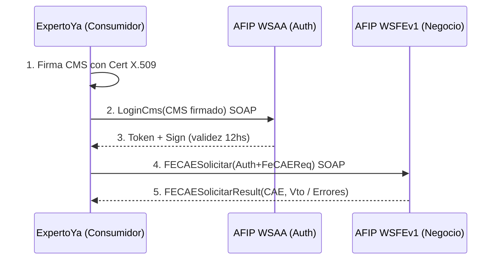

# TP3 Actividad 1 Punto 2 - Caso Real SOAP: AFIP Facturación Electrónica (WSAA + WSFEv1)

## 1. Caso elegido y necesidad

**Caso:** Consumo del servicio SOAP de Facturación Electrónica de AFIP/ARCA para autorizar comprobantes (CAE/CAEA).

**Necesidad que resuelve:** Todo servicio facturado en ExpertoYa (ej: un profesional cobra una reparación) debe tener validez fiscal. La ley exige pedir a AFIP un Código de Autorización Electrónico (CAE) antes de emitir la factura. Sin SOAP no hay factura legal.

**Dominio TP Final:** `Profesional -> Servicio -> Factura`. ExpertoYa actuaría como cliente consumidor.

## 2. Sistemas que intervienen

- **Consumidor:** ERP de ExpertoYa (backend Node/Express). Inicia la comunicación.
- **Proveedor Auth:** AFIP WSAA - WebService de Autenticación y Autorización. Entrega Token+Sign.
- **Proveedor Negocio:** AFIP WSFEv1 - WebService de Facturación Electrónica. Autoriza facturas.
- **Canal:** HTTPS + XML SOAP 1.1/1.2.

Flujo: ERP firma CMS con certificado X.509 -> pide ticket a WSAA -> usa ticket para pedir CAE a WSFEv1.

## 3. Diagrama de consumo SOAP

# 4. Cuadro de análisis técnico

| Elemento Punto 1       | Identificado en AFIP                                                                                   | Valor / Ejemplo real                                                                                                                                                                                                                                   | Justificación                                                                                                       |
| ---------------------- | ------------------------------------------------------------------------------------------------------ | ------------------------------------------------------------------------------------------------------------------------------------------------------------------------------------------------------------------------------------------------------ | ------------------------------------------------------------------------------------------------------------------- |
| **Protocolo SOAP**     | SOAP 1.1 y 1.2                                                                                         | `Content-Type: text/xml` y `application/soap+xml`, `SOAPAction: "http://ar.gov.afip.dif.FEV1/FECAESolicitar"`                                                                                                                                          | Contrato estricto necesario para validez fiscal, no basta REST suelto.                                              |
| **WSDL**               | WSDL público                                                                                           | Homo: `https://wswhomo.afip.gov.ar/wsfev1/service.asmx?WSDL` Prod: `https://servicios1.afip.gov.ar/wsfev1/service.asmx?WSDL`                                                                                                                           | Describe operaciones, mensajes y tipos. Se ve con `?WSDL` en navegador.                                             |
| **Operaciones**        | `LoginCms`, `FECAESolicitar`, `FECompUltimoAutorizado`, `FEParamGetTiposCbte`, `FEDummy`               | `FECAESolicitar` = pedir CAE, `FECompUltimoAutorizado` = último nro.                                                                                                                                                                                   | Cada `wsdl:operation` es una función remota. Principal: `FECAESolicitar`.                                           |
| **Mensajes XML**       | Request `FECAESolicitar(Auth,FeCAEReq)`, Response `FECAESolicitarResponse(FeCabResp,FeDetResp,Errors)` | Request lleva `<Auth><Token>string</Token><Sign>string</Sign><Cuit>long</Cuit></Auth>` Response devuelve `<CAE>string</CAE><CAEFchVto>string</CAEFchVto>`                                                                                              | Envelope/Body estándar SOAP. Si hay error viene en `<Errors><Err><Code>int</Code><Msg>string</Msg></Err></Errors>`. |
| **Tipos de Datos XSD** | XSD incorporado en WSDL                                                                                | `string: Token,Sign,CAE`, `long: Cuit`, `int: CbteTipo,PtoVta`, `double: ImpTotal,ImpNeto`                                                                                                                                                             | Tipado fuerte permite validar factura antes de autorizar.                                                           |
| **Endpoint**           | URL distinta homo/prod                                                                                 | WSFE homo: `https://wswhomo.afip.gov.ar/wsfev1/service.asmx` WSFE prod: `https://servicios1.afip.gov.ar/wsfev1/service.asmx` WSAA homo: `https://wsaahomo.afip.gov.ar/ws/services/LoginCms` WSAA prod: `https://wsaa.afip.gov.ar/ws/services/LoginCms` | `soap:address location` del WSDL. Homo para probar, prod para real.                                                 |
| **Seguridad**          | WS-Security + X.509 + HTTPS                                                                            | 1. Certificado digital de clave fiscal 2. CMS firmado para `LoginCms` 3. Ticket `service=wsfe` 12hs 4. HTTPS                                                                                                                                           | Exige no repudio e integridad fiscal. Muy superior a API-key simple de REST.                                        |
| **UDDI**               | Sin UDDI público                                                                                       | Endpoint se obtiene por documentación oficial, no por directorio UDDI                                                                                                                                                                                  | Confirma teoría: UDDI cayó en desuso, se reemplaza por docs/portales. Se justifica su ausencia.                     |

# 5. Ejemplo simple de mensaje SOAP

<!-- Request FECAESolicitar -->

<soap:Envelope xmlns:soap="http://schemas.xmlsoap.org/soap/envelope/">
<soap:Body>
<FECAESolicitar xmlns="http://ar.gov.afip.dif.FEV1/">
<Auth><Token>TOKEN_WSAA</Token><Sign>SIGN_WSAA</Sign><Cuit>20123456789</Cuit></Auth>
<FeCAEReq>
<FeCabReq><CantReg>1</CantReg><PtoVta>1</PtoVta><CbteTipo>11</CbteTipo></FeCabReq>
<FeDetReq><FECAEDetRequest><DocTipo>99</DocTipo><DocNro>0</DocNro><ImpTotal>1210.0</ImpTotal></FECAEDetRequest></FeDetReq>
</FeCAEReq>
</FECAESolicitar>
</soap:Body>
</soap:Envelope>

# 6. Fuentes consultadas

1. AFIP - Manual Desarrollador WSFEv1 v4.0 (2025) - afip.gob.ar/ws/documentacion/
2. AFIP - Documentación WSAA: afip.gob.ar/ws/documentacion/wsaa.asp - URLs LoginCms homo/prod.
3. WSDL vivo: servicios1.afip.gov.ar/wsfev1/service.asmx?op=FECAESolicitar (ejemplos SOAP 1.1/1.2).
