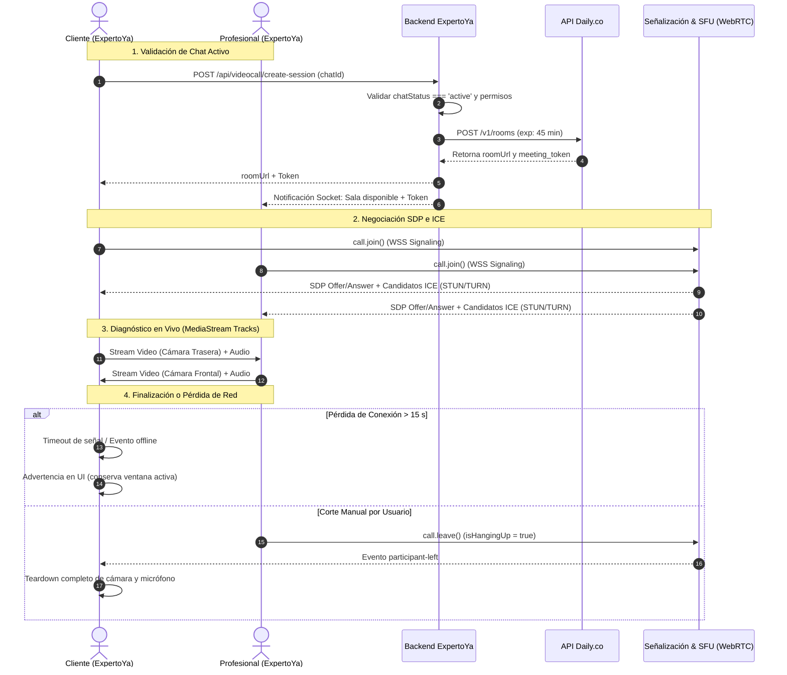

# TP3 — Actividad 2 (API 3): Videollamadas WebRTC para Diagnóstico Preliminar
**Autora:** Abril  
**Rol:** Desarrolladora Full-Stack & Auditora UI/UX Accesible  
**Proyecto:** ExpertoYa (Plataforma transaccional de oficios tradicionales)  
**Materia:** Frameworks e Interoperabilidad  

---

## 1. Comparativa Técnica de Proveedores WebRTC en React

Para habilitar la funcionalidad de diagnóstico visual en vivo entre clientes y profesionales en ExpertoYa, se realizó una evaluación comparativa entre las tres principales plataformas de Comunicaciones en Tiempo Real (RTC) basadas en la nube: **Daily.co**, **Agora.io** y **ZegoCloud**.

### 1.1 Matriz de Evaluación

| Criterio Evaluado | **Daily.co** | **Agora.io** | **ZegoCloud** |
| :--- | :--- | :--- | :--- |
| **Facilidad de Integración en React** | **Excelente (5/5)**: Provee los paquetes oficiales `@daily-co/daily-js` y `@daily-co/daily-react`. Su diseño permite un desacoplamiento absoluto de la interfaz visual (*headless*), administrando la transmisión mediante referencias directas a elementos `<video ref={...} />`. Esto facilita la aplicación directa de clases de Tailwind CSS sin requerir iframes obligatorios ni lidiar con hojas de estilo externas inyectadas. | **Media (3.5/5)**: Dispone del SDK `agora-rtc-react` (v2), pero su arquitectura impone un proveedor de contexto rígido (`AgoraRTCProvider`) y una curva de aprendizaje pronunciada en backend, ya que la autenticación exige la generación criptográfica de tokens HMAC mediante algoritmos de privilegios por canal (`RtcTokenBuilder`). | **Baja-Media (3/5)**: Su SDK Web (`zego-express-engine-webrtc`) se apoya fuertemente en callbacks tradicionales y requiere manipulación directa del DOM. Sus kits de interfaz cerrada (*UIKits*) entran en conflicto directo con manuales de identidad visual corporativos estrictos. |
| **Límites de la Capa Gratuita (Free Tier)** | **10.000 minutos mensuales gratuitos de por vida**. Acceso total a la API REST para el aprovisionamiento instantáneo de salas con expiración programada (*TTL*). No requiere tarjeta de crédito para iniciar pruebas de desarrollo. Admite llamadas bilaterales (P2P) y grupales (SFU) de hasta 50 participantes concurrentes dentro de la cuota. | **10.000 minutos mensuales gratuitos**. Sin embargo, la tarificación posterior diferencia según la resolución recibida (audio, video estándar, video HD y Full HD). Algunas funciones avanzadas de red o reportes de calidad requieren validación bancaria o depósito inicial. | **10.000 minutos mensuales gratuitos**. Su modelo posterior de costos impone topes estrictos de bitrate y perfiles de video. En modo de prueba existen límites de concurrencia simultánea que restringen la ejecución de pruebas de carga en equipo. |
| **Calidad de Transmisión y Latencia** | **Sobresaliente**: Implementa conmutación híbrida automática entre **P2P Mesh** directo (óptimo para llamadas 1-a-1 sin costo de servidor ni latencia intermedia) y **SFU** distribuido geográficamente si existen cortafuegos corporativos o NAT simétrico. Emplea *Simulcast* y adaptación dinámica de bitrate ante fluctuaciones de redes 4G/5G en smartphones. Latencia típica: 150–250 ms. | **Líder en Infraestructura**: Utiliza una red propietaria SD-RTN (*Software-Defined Real-time Network*). Destaca por su alta tolerancia a la pérdida de paquetes (hasta 70% mediante algoritmos ARQ y FEC), manteniendo latencias globales bajas (~200 ms). | **Buena en Streaming**: Adecuada para streaming unidireccional y entretenimiento interactivo. En WebRTC bidireccional sobre navegadores móviles (Safari iOS y Chrome Android) presenta microcortes ocasionales al conmutar entre Wi-Fi y datos móviles. |
| **Documentación y Developer Experience (DX)** | **Excelente**: Documentación moderna, interactiva y estructurada con foco específico en React, Next.js y TypeScript. Incluye recetas de código concisas para casos de uso reales en dispositivos móviles (ej. conmutación en caliente de `facingMode` para cámara trasera). | **Regular a Extensa**: Documentación sumamente abarcativa pero fragmentada por sucesivas transiciones de versiones (Web SDK v3, v4, NG, React v1 y v2). Muchos foros y tutoriales de la comunidad contienen fragmentos de código deprecados. | **Deficiente**: Documentación traducida automáticamente con inconsistencias idiomáticas. Su enfoque prioriza soluciones *low-code* con plantillas predeterminadas, ofreciendo escasa orientación para arquitecturas *custom* en React puro. |

---

## 2. Justificación Técnica de la Elección para "ExpertoYa"

Para la arquitectura transaccional de **ExpertoYa**, cuyo propósito es **agilizar la emisión de presupuestos mediante diagnósticos preliminares en vivo entre clientes locales y profesionales de oficios** (plomeros, electricistas, gasistas, técnicos en refrigeración), **Daily.co** resulta la opción técnica superior por cuatro motivos concluyentes:

1. **Aceleración del Time-to-Market y Menor Complejidad en Backend**: Daily.co permite aprovisionar salas de diagnóstico efímeras con expiración automática mediante una simple petición REST (`POST https://api.daily.co/v1/rooms`) enviando un parámetro `exp: timestamp`. Esto elimina la necesidad de desarrollar y mantener un servicio criptográfico de tokens de canal en Node.js (como exige Agora), reduciendo drásticamente los puntos de falla y el esfuerzo de integración en el backend.
2. **Control Total de la Interfaz Visual (Tailwind CSS & Accesibilidad)**: Gracias al modelo *headless* de `@daily-co/daily-js`, el SDK actúa como un motor de medios puro. Esto permite enlazar el flujo de video a nodos HTML estándar (`<video ref={...} />`), aplicando de forma limpia y directa las clases de Tailwind CSS, la paleta de colores del Manual de Identidad Visual (modo claro/oscuro) y los requerimientos de contraste WCAG AA, sin sufrir las limitaciones de los iframes o componentes cerrados de ZegoCloud.
3. **Optimización P2P para Diagnóstico de Alta Resolución (1-a-1)**: La llamada entre el cliente y el profesional es por naturaleza bilateral. Daily.co establece automáticamente una topología P2P directa cuando las condiciones de red lo permiten, evitando servidores intermedios y alcanzando resoluciones nativas de hasta 1080p a 30 fps con mínima latencia. Esto es vital para que un electricista distinga los cables de un tablero o un plomero observe una fisura sin artefactos de compresión.
4. **Soporte Nativo para Conmutación de Cámara en Smartphones**: En ExpertoYa, el cliente suele estar frente al desperfecto y necesita alternar rápidamente a la cámara trasera (`facingMode: 'environment'`) para mostrar el problema mientras dialoga con el profesional. Daily.co resuelve este cambio en caliente mediante `setInputDevicesAsync` sin reiniciar el canal de señalización ni provocar congelamientos de pantalla.

---

## 3. Documentación del Flujo de Conexión (Bajo el Capó)

El ciclo de vida de una videollamada de diagnóstico en ExpertoYa comprende cinco fases técnicas bien definidas:

### Fase 1: Validación y Aprovisionamiento Seguro en Backend
1. El usuario solicita el diagnóstico visual desde la interfaz de chat.
2. El frontend envía una petición autenticada `POST /api/videocall/create-session` con el `chatId`.
3. El backend valida de forma estricta que:
   * El chat exista y su estado sea `ACTIVE`.
   * El usuario autenticado sea parte de la conversación (cliente o profesional asignado).
4. El backend se comunica con la API de Daily.co (`POST /v1/rooms`), creando una sala privada con un tiempo de vida (*TTL*) de 45 minutos. Opcionalmente genera un *Meeting Token* firmado que individualiza al participante.
5. El backend devuelve la URL de la sala (`roomUrl`) y el token al frontend.

### Fase 2: Señalización WebRTC y Negociación SDP / ICE
1. Al renderizarse el componente `VideoCallRoom`, se verifica el singleton `DailyIframe.getCallInstance()` para prevenir errores de doble montaje bajo React 19 `StrictMode`.
2. Se inicia una conexión de señalización mediante **WebSockets seguros (WSS)** con la infraestructura de Daily.co.
3. **Oferta y Respuesta SDP (*Session Description Protocol*)**: Los navegadores intercambian capacidades multimedia (códecs de audio Opus a 48 kHz, códecs de video VP8 o H.264, resoluciones de envío/recepción).
4. **Candidatos ICE (*Interactive Connectivity Establishment*)**: Los clientes interrogan servidores **STUN** para descubrir su IP pública y puertos mapeados. En conexiones celulares restringidas (NAT simétrico), la llamada recurre a servidores de retransmisión **TURN** bajo canales cifrados TLS/SRTP para sortear bloqueos de red.

### Fase 3: Adquisición de Medios y Negociación de Tracks
1. El navegador ejecuta `navigator.mediaDevices.getUserMedia({ audio: true, video: { facingMode: 'user' } })`.
2. Se genera un objeto `MediaStream` con dos instancias de `MediaStreamTrack` independientes (audio y video).
3. Los tracks locales se enlazan al elemento `<video ref={localVideoRef} />` y a la *PeerConnection*.
4. **Control Granular**: Cuando el usuario silencia el audio o apaga el video, se ejecutan `setLocalAudio(false)` o `setLocalVideo(false)`. Esto modifica la propiedad `track.enabled = false` o detiene el envío de paquetes RTP sin romper la negociación WebRTC, preservando la sesión y reduciendo el consumo de batería y datos móviles.

### Fase 4: Topología P2P Mesh con Conmutación a SFU
1. La llamada se inicializa en topología **Mesh P2P directa**, viajando los paquetes de audio y video directamente entre el dispositivo del cliente y el del especialista.
2. Si las condiciones de red descienden o uno de los peers está detrás de un cortafuegos estricto, la arquitectura conmuta automáticamente a un nodo **SFU (*Selective Forwarding Unit*)**. El servidor SFU distribuye el flujo aplicando *Simulcast*, adaptando la tasa de bits para evitar la saturación del ancho de banda celular del cliente.

### Fase 5: Resiliencia de Red, Modo Demostración y Desmontaje Seguro
1. **Control de Cuelgue Manual y Resiliencia**: Para evitar cierres prematuros provocados por desconexiones transitorias de red, se implementó una referencia de estado `isHangingUpRef`. El modal y la llamada solo se cierran cuando el usuario presiona voluntariamente el botón rojo "Cortar" o la cruz superior "X".
2. **Modo Demo Local**: Si la llamada se ejecuta en un entorno de desarrollo sin una sala creada en la nube de Daily.co, el componente realiza un fallback automático adquiriendo la cámara local vía `getUserMedia`, garantizando que la previsualización y todos los controles interactivos funcionen de inmediato.
3. **Limpieza Rigurosa (Teardown)**: Al colgar o desmontarse el componente (`useEffect cleanup`), se invocan `call.leave()` y `call.destroy()`, y se ejecuta `track.stop()` sobre todos los dispositivos locales. Esto apaga de forma inmediata el LED físico de la cámara y libera los recursos del hardware, garantizando la privacidad del usuario y evitando fugas de memoria (*memory leaks*).

### Diagrama de Secuencia del Flujo WebRTC

---

## 4. Auditoría de UI/UX y Cumplimiento del Manual de Identidad Visual

Como responsable del área de **Diseño UI/UX y Accesibilidad Web** del equipo NoCode, realicé una auditoría exhaustiva sobre las tres implementaciones del Trabajo Práctico:

### 4.1. Auditoría de API 1: Geolocalización y Mapeo de Profesionales Cercanos (Leaflet + OpenStreetMap)
* **Tipografía:** Se forzó la clase `font-sans` (**Plus Jakarta Sans**) en los popups descriptivos de los profesionales y en las etiquetas informativas de distancia.
* **Paleta y Modo Claro / Oscuro:** Los marcadores vectoriales usan el Naranja corporativo `#FF8C00` para la posición del especialista y el Teal `#00BFA5` para delimitar el área de servicio. En modo oscuro, el contenedor del mapa implementa bordes en `#374151` y filtros adaptativos para evitar deslumbramientos.
* **Accesibilidad (WCAG AA):** Controles de zoom y centrado con etiquetas accesibles `aria-label`, contraste superior a 4.5:1 en los textos informativos y operabilidad total mediante teclado.

### 4.2. Auditoría de API 2: Procesamiento Transaccional / Notificaciones (Reseñas Closed-Loop)
* **Tipografía:** Plus Jakarta Sans aplicada uniformemente a títulos, inputs de texto, métricas agregadas y comentarios (`ResenaForm.tsx` y `ResenasList.tsx`).
* **Paleta Corporativa:** Botón de publicación con el Naranja primario `#FF8C00` (hover `#e67e00`), estrellas de calificación reactivas en Naranja corporativo (`fill-[#FF8C00]`), badges de servicio en Teal `#00BFA5`, fondos en `#FDFCF4` (modo claro) y `#121826` / `#1F2937` (modo oscuro).
* **Accesibilidad (WCAG AA) y Doble Codificación Visual:**
  * Las valoraciones y estados nunca dependen únicamente del color: las estrellas interactivas incluyen textos legibles para lectores de pantalla ("4 de 5 estrellas").
  * Los mensajes de error y confirmación utilizan colores semánticos (`#10B981` éxito, `#EF4444` error) acompañados de iconos SVG de `lucide-react` (`AlertCircle`, `CheckCircle2`) que garantizan la comprensión para usuarios con daltonismo.

### 4.3. Auditoría de API 3: Videollamadas WebRTC para Diagnóstico Preliminar (Daily.co)
* **Tipografía:** Plus Jakarta Sans en cabecera de la sala, badges de participantes y barra de control.
* **Paleta Estricta:**
  * Modo Claro: Fondo `#FDFCF4`, textos `#283593` (Ratio de contraste 12.8:1, nivel AAA), botones `#FF8C00`, acentos `#00BFA5`.
  * Modo Oscuro: Fondo base `#121826`, barra de control `#1F2937`, botones `#FFB74D`, acentos `#33EFA5`.
  * Semántica de Peligro: Botón de corte en Rojo `#EF4444` (modo claro) y `#F87171` (modo oscuro) con contraste auditado.
* **Accesibilidad Universal:**
  * **Independencia cromática absoluta:** Todos los botones poseen iconos SVG explícitos (micrófono normal vs. tachado, cámara encendida vs. tachada, flechas de conmutación de lente y auricular de corte en ángulo) junto a etiquetas de texto descriptivas.
  * **Foco y Atributos ARIA:** Atributos `aria-label`, `aria-pressed`, `role="button"` y anillo de foco visible (`focus:ring-2 focus:ring-offset-2`).

### 4.4. Matriz Comparativa de Cumplimiento de Identidad y Accesibilidad

| Criterio de Auditoría | API 1: Geolocalización (OSM) | API 2: Transaccional (Reseñas) | API 3: WebRTC (Videollamadas) |
| :--- | :---: | :---: | :---: |
| **Tipografía Plus Jakarta Sans** | Conforme (100%) | Conforme (100%) | Conforme (100%) |
| **Modo Claro (`#FDFCF4` / `#283593`)** | Conforme | Conforme | Conforme (12.8:1 AAA) |
| **Modo Oscuro (`#121826` / `#1F2937`)** | Conforme | Conforme | Conforme (> 7:1 AA) |
| **Naranja Institucional (`#FF8C00` / `#FFB74D`)** | Conforme (Marcadores) | Conforme (Estrellas y Submit) | Conforme (Botones Primarios) |
| **Teal Acento (`#00BFA5` / `#33EFA5`)** | Conforme (Radio) | Conforme (Badges) | Conforme (Señal y Bordes) |
| **Semántica de Peligro (`#EF4444` / `#F87171`)** | N/A | Conforme (Validaciones) | Conforme (Botón Cortar) |
| **Doble Codificación (No solo color)** | Conforme | Conforme (Iconos + Texto) | Conforme (Iconos SVG + Texto) |
| **Dictamen de Accesibilidad (WCAG 2.1 AA)** | **APROBADO** | **APROBADO** | **APROBADO** |
