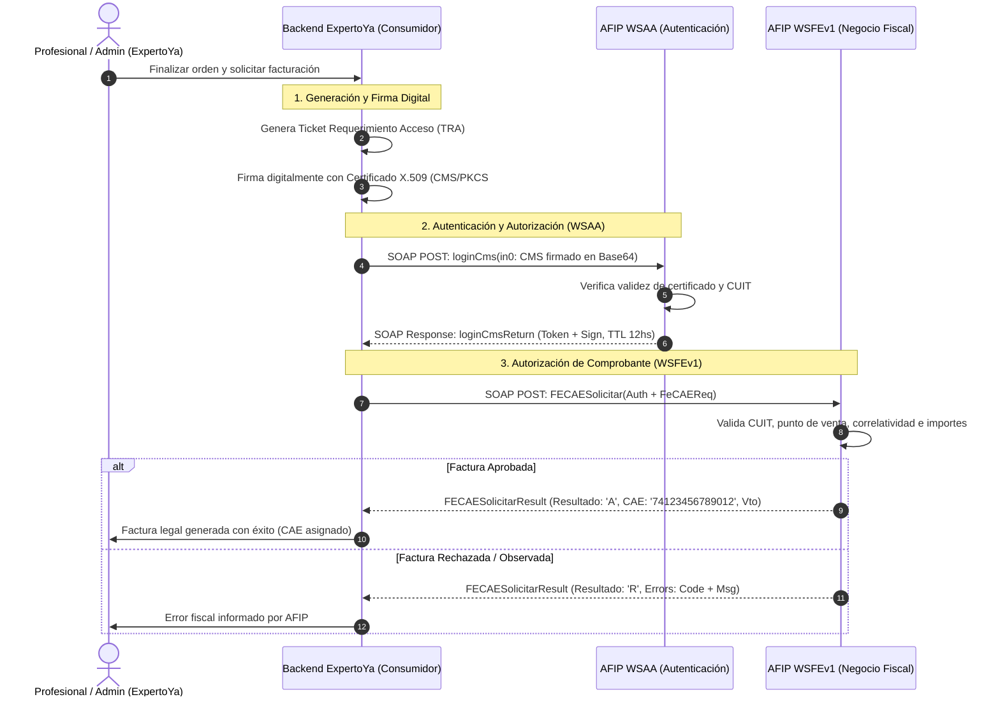
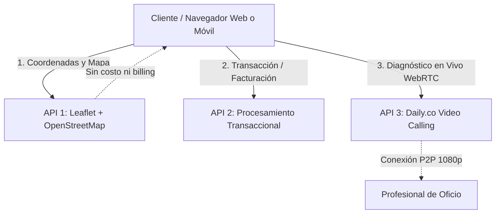
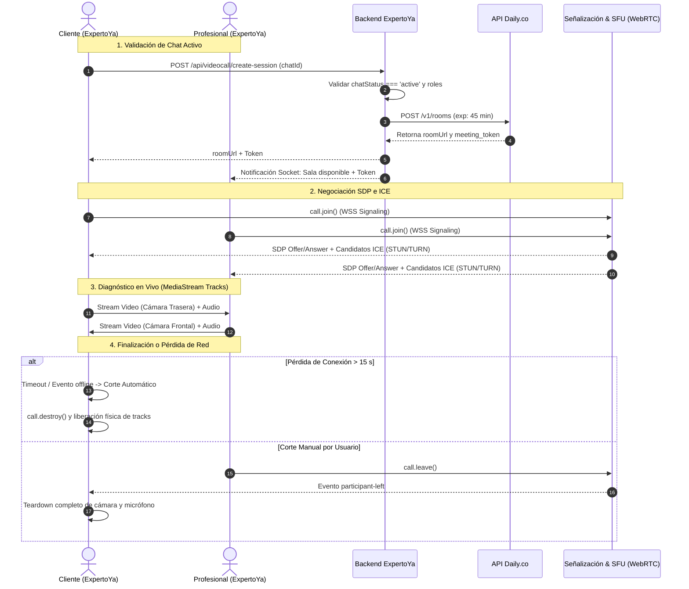

# TRABAJO PRÁCTICO Nº 3: FRAMEWORKS E INTEROPERABILIDAD
## Módulo de Integración de Servicios, Arquitecturas Heterogéneas y Comunicación en Tiempo Real en "ExpertoYa"

**Universidad / Cátedra:** Frameworks e Interoperabilidad 2026  
**Equipo de Desarrollo:** "NoCode"  
**Integrantes y Roles:**
* **Daniela:** Investigación teórica SOAP vs REST, estándares WSDL, UDDI y seguridad WS-Security.
* **Erick:** Análisis de caso real SOAP (AFIP/ARCA Facturación Electrónica), dominios de aplicación y API 1 de Geolocalización (Leaflet + OpenStreetMap).
* **Abril:** Integración de API 3 WebRTC (Daily.co en React), auditoría de accesibilidad y cumplimiento del Manual de Identidad Visual (Tailwind CSS), y consolidación del informe final.

---

## Índice General
1. [Introducción y Contexto del Proyecto ExpertoYa](#1-introducción-y-contexto-del-proyecto-expertoya)
2. [Actividad 1: Protocolos y Arquitecturas de Integración (SOAP vs REST)](#2-actividad-1-protocolos-y-arquitecturas-de-integración-soap-vs-rest)
   - 2.1. [Fundamentos Teóricos de SOAP y Comparativa con REST (Daniela)](#21-fundamentos-teóricos-de-soap-y-comparativa-con-rest-daniela)
   - 2.2. [Caso de Estudio Real SOAP: AFIP/ARCA Facturación Electrónica (Erick)](#22-caso-de-estudio-real-soap-afiparca-facturación-electrónica-erick)
   - 2.3. [Dominios Críticos donde se Prefiere SOAP frente a REST (Erick)](#23-dominios-críticos-donde-se-prefiere-soap-frente-a-rest-erick)
3. [Actividad 2: Ecosistema e Integración de las 3 APIs en ExpertoYa](#3-actividad-2-ecosistema-e-integración-de-las-3-apis-en-expertoya)
   - 3.1. [API 1: Geolocalización y Mapeo de Profesionales Cercanos (Erick)](#31-api-1-geolocalización-y-mapeo-de-profesionales-cercanos-erick)
   - 3.2. [API 2: Procesamiento Transaccional / Notificaciones (Sistema de Reseñas Closed-Loop)](#32-api-2-procesamiento-transaccional--notificaciones-sistema-de-reseñas-closed-loop)
   - 3.3. [API 3: Videollamadas WebRTC para Diagnóstico Preliminar Visual en Vivo (Abril)](#33-api-3-videollamadas-webrtc-para-diagnóstico-preliminar-visual-en-vivo-abril)
4. [Auditoría UI/UX y Manual de Identidad Visual (Tailwind CSS)](#4-auditoría-uiux-y-manual-de-identidad-visual-tailwind-css)
5. [Conclusiones Generales sobre Interoperabilidad en ExpertoYa](#5-conclusiones-generales-sobre-interoperabilidad-en-expertoya)
6. [Referencias y Bibliografía](#6-referencias-y-bibliografía)

---

## 1. Introducción y Contexto del Proyecto ExpertoYa

**ExpertoYa** es una plataforma web y móvil transaccional concebida para conectar de manera ágil a clientes locales con profesionales y técnicos de oficios tradicionales (electricistas, plomeros, gasistas, albañiles, técnicos de climatización).

Uno de los principales cuellos de botella en la contratación de oficios es el **proceso de presupuestación preliminar**: tradicionalmente, el profesional debe desplazarse físicamente hasta el domicilio para evaluar una falla menor (por ejemplo, una fuga en una unión o un cortocircuito en un disyuntor), incurriendo en pérdidas de tiempo y costos de transporte no reembolsables.

Para resolver este desafío, la plataforma adopta un enfoque de **interoperabilidad modular**, combinando:
1. **Servicios Web Seguros y Formales (SOAP)** para el cumplimiento tributario ineludible en la facturación de servicios con validez fiscal en Argentina.
2. **Servicios Ligeros y Cacheables (REST/JSON)** para consultas de alta concurrencia, geocodificación y navegación en mapas locales.
3. **Comunicaciones en Tiempo Real P2P (WebRTC)** para permitir diagnósticos visuales preliminares en vivo mediante videollamadas con soporte de conmutación de cámaras en smartphones.

---

## 2. Actividad 1: Protocolos y Arquitecturas de Integración (SOAP vs REST)

### 2.1. Fundamentos Teóricos de SOAP y Comparativa con REST (Daniela)

*Resumen del Módulo:*  
SOAP (*Simple Object Access Protocol*) se caracteriza por ser un protocolo formal basado estrictamente en contratos XML, tipado fuerte mediante esquemas XSD y definición de interfaces mediante WSDL, garantizando interoperabilidad independiente de la plataforma emisora y receptora. Frente a REST, que opera como un estilo arquitectónico centrado en recursos y verbos HTTP nativos, SOAP ofrece garantías a nivel de mensaje (*WS-Security*, *WS-ReliableMessaging*), a expensas de una mayor sobrecarga de procesamiento y ancho de banda.

#### 2.1.1. SOAP: Arquitectura y Componentes Principales

##### A. Definición y Finalidad
**SOAP** (*Simple Object Access Protocol*) es un protocolo de comunicación que permite intercambiar información estructurada entre aplicaciones mediante mensajes en formato **XML** (*Extensible Markup Language*). Su finalidad primordial es establecer reglas estandarizadas y universales para que distintos sistemas informáticos puedan interoperar, con total independencia del lenguaje de programación (Java, C#, Python, Node.js) o del sistema operativo y plataforma en la que estén implementados.

Por ejemplo, una aplicación cliente desarrollada en Java o React puede comunicarse de forma transparente con un servicio empresarial desarrollado en C# sobre Microsoft .NET mediante SOAP, siempre que ambos extremos respeten rigurosamente las especificaciones del protocolo y el contrato de comunicación formal acordado.

En el ecosistema de **ExpertoYa**, una aplicación externa (por ejemplo, un sistema de gestión de colegios profesionales o un CRM corporativo) podría solicitar los datos de un profesional registrado en la plataforma. Para ello, el sistema emite una solicitud SOAP con el identificador del profesional y recibe como respuesta un documento XML con información validada: nombre, oficio, estado de matrícula verificada y calificación promedio histórica.

Entre las características distintivas de SOAP se destacan:
* **Interoperabilidad Universal:** Facilita la comunicación entre sistemas heterogéneos mediante la neutralidad de XML y transportes estándar.
* **Estructura Formal y Tipado Fuerte:** Establece reglas sintácticas y semánticas precisas para organizar las solicitudes, las respuestas y los mensajes de error, apoyándose en esquemas XML Schema (XSD).
* **Extensibilidad Modular:** Permite incorporar información complementaria en cabeceras estandarizadas (`soap:Header`), posibilitando la adición de capas transversales como seguridad (*WS-Security*), transacciones distribuidas (*WS-AtomicTransaction*) o enrutamiento (*WS-Addressing*).
* **Contrato Técnico Inmutable:** Se complementa de manera natural con WSDL, que describe exhaustivamente los métodos disponibles, tipos y puertos de enlace.
* **Flexibilidad de Mecanismos de Transporte:** Aunque opera predominantemente sobre HTTP/HTTPS en la Web, el protocolo está diseñado para desacoplarse del transporte, pudiendo transmitirse sobre SMTP, JMS (*Java Message Service*) o TCP directo.

> **Principio de Diseño:** SOAP define con exactitud cómo se estructuran, serializan y procesan los mensajes entre emisores, intermediarios y receptores, pero no asume por sí solo la lógica de negocio ni provee seguridad por omisión si no se configuran explícitamente las especificaciones *WS-**.

##### B. Arquitectura y Funcionamiento
En el flujo de comunicación SOAP intervienen formalmente los siguientes participantes:
* **Cliente o Consumidor:** Aplicación que prepara la solicitud, ensambla el payload XML y demanda la ejecución de una operación o consulta remota.
* **Servidor o Proveedor:** Sistema que expone el servicio, valida la conformidad del mensaje recibido frente al esquema, ejecuta la lógica de negocio y genera el mensaje SOAP de respuesta.
* **Intermediarios (*Nodes / SOAP Intermediaries*):** Nodos intermedios (servidores proxy, pasarelas de seguridad o brokers de mensajería) capaces de procesar, auditar o enrutar cabeceras específicas antes de reenviar el mensaje a su destino final.

El ciclo de invocación sincrónica responde a los siguientes pasos:
1. El consumidor identifica la operación a ejecutar y construye la solicitud XML conforme al contrato.
2. La solicitud se serializa dentro del envelope SOAP y se envía al *endpoint* de red del servicio a través de HTTP/HTTPS (típicamente mediante el método `POST`).
3. El servidor receptor recibe el stream XML, efectúa la validación sintáctica y de tipos mediante el validador XSD, y despacha la invocación al controlador correspondiente.
4. Finalizada la ejecución, el servidor construye un mensaje SOAP de respuesta conteniendo los datos devueltos o, en caso de fallas o excepciones, una estructura normalizada de error (`Fault`).
5. El cliente recibe la respuesta HTTP, deserializa el payload XML y procesa el resultado tipado.

En la arquitectura de referencia de servicios web orientados a servicios (SOA) se establecen tres roles arquetípicos:
* **Proveedor:** Implementa, expone y publica el servicio.
* **Consumidor:** Descubre, obtiene el contrato y enlaza el servicio.
* **Registro (*Service Broker*):** Directorio centralizado que permite publicar y localizar servicios web (rol asignado originalmente a UDDI).

##### C. Componentes Principales de un Mensaje SOAP
Un mensaje SOAP es un documento XML bien formado que responde a una jerarquía estricta compuesta por cuatro elementos:

1. **Envelope (`<soap:Envelope>`):** Es el elemento raíz obligatorio del documento XML. Identifica formalmente que el mensaje pertenece a la especificación SOAP mediante su espacio de nombres (*namespace*) y delimita el inicio y fin de la estructura.
2. **Header (`<soap:Header>`):** Elemento opcional que precede inmediatamente al cuerpo. Permite transmitir metadatos de control y directivas de procesamiento que no forman parte del cuerpo funcional, tales como credenciales de autenticación, firmas digitales, identidades de sesión o marcas de tiempo (*timestamps*). Admite atributos como `mustUnderstand="1"`, que exige al receptor procesar obligatoriamente la cabecera o abortar la solicitud.
3. **Body (`<soap:Body>`):** Elemento obligatorio que alberga la carga útil (*payload*) del mensaje. En una solicitud, contiene el nombre de la operación a invocar y sus parámetros tipados; en una respuesta exitosa, transporta las estructuras de datos devueltas por la operación.
4. **Fault (`<soap:Fault>`):** Sub-elemento reservado que reside dentro del `Body` y se utiliza exclusivamente cuando se produce un error en el procesamiento del mensaje. Provee un mecanismo uniforme para reportar fallos tanto a nivel de transporte como de negocio mediante sub-elementos estándar:
   * `faultcode`: Código que clasifica la naturaleza del error (ej. `Client`, `Server`, `VersionMismatch`, `MustUnderstand`).
   * `faultstring`: Descripción textual legible de la causa de la falla.
   * `faultactor`: Identificador del actor o nodo en la cadena de intermediarios que generó la falla.
   * `detail`: Contenedor XML destinado a brindar información técnica o mensajes de error específicos de la aplicación.

```xml
<?xml version="1.0" encoding="UTF-8"?>
<soap:Envelope 
    xmlns:soap="http://schemas.xmlsoap.org/soap/envelope/"
    soap:encodingStyle="http://schemas.xmlsoap.org/soap/encoding/">
    
    <soap:Header>
        <!-- Metadatos de seguridad, enrutamiento o timestamps -->
    </soap:Header>
    
    <soap:Body>
        <!-- Carga útil: Datos de la operación de negocio o Fault en caso de error -->
    </soap:Body>
</soap:Envelope>
```

##### D. XML y Protocolos de Transporte
XML aporta legibilidad, extensibilidad y estructura jerárquica estandarizada. La rigidez de SOAP descansa en la capacidad de asociar esquemas **XML Schema Definition (XSD)**, permitiendo verificar de manera anticipada que un campo cumpla con restricciones como:
```xml
<xsd:element name="idProfesional" type="xsd:int"/>
<xsd:element name="matriculaVerificada" type="xsd:boolean"/>
<xsd:element name="calificacionPromedio" type="xsd:decimal"/>
```
En materia de transporte, aunque HTTP y HTTPS representan la opción ubicua en el 95% de los casos debido a su facilidad para atravesar firewalls corporativos mediante los puertos 80 y 443, la especificación de SOAP permite operar sobre protocolos de colas de mensajes como JMS o AMQP, asegurando entrega asíncrona desacoplada en infraestructuras de misión crítica.

---

#### 2.1.2. WSDL: Descripción de Servicios Web y Contrato Formal

##### A. Definición y Relación con SOAP
**WSDL** (*Web Services Description Language*) es una gramática basada en XML concebida para describir formalmente la interfaz pública de un servicio web. Opera como un **contrato legal vinculante e inmutable** entre el proveedor del servicio y cualquier aplicación consumidora, precisando con total exactitud matemática qué funciones ofrece el servicio, qué parámetros de entrada requiere, qué estructura posee la respuesta, qué tipos de datos se emplean y a qué dirección de red debe remitirse la comunicación.

La relación entre ambas tecnologías es de complementariedad estricta:
* **SOAP** constituye el protocolo de empaquetado y transporte del mensaje.
* **WSDL** constituye el manual de instrucciones y el plano de construcción que indica cómo debe ensamblarse dicho mensaje para ser aceptado por el servicio.

##### B. Elementos Esenciales de un Documento WSDL 1.1
Un documento WSDL organiza la definición del servicio en capas abstractas y concretas:

* **Tipos de Datos (`<types>`):** Sección que define los tipos de datos utilizados en los mensajes mediante esquemas XSD (`xsd:schema`). Define tanto tipos primitivos (`xsd:string`, `xsd:int`) como tipos complejos (`xsd:complexType`, `xsd:sequence`).
* **Mensajes (`<message>`):** Define de forma abstracta la composición de los datos transmitidos en una invocación. Cada mensaje se compone de una o más partes (`<part>`) que referencian a los elementos definidos en `<types>`.
* **Operaciones (`<operation>`):** Representa una acción individual soportada por el servicio (equivalente a un método de clase). Define el patrón de intercambio de mensajes: típicamente una entrada (`<input>`), una salida (`<output>`) y, opcionalmente, fallos (`<fault>`).
* **Interfaz Abstracta (`<portType>`):** Agrupa un conjunto homogéneo de operaciones relacionadas, definiendo la interfaz funcional abstracta del servicio sin atarse a ninguna implementación de red específica.
* **Vinculación o Enlace (`<binding>`):** Asigna un protocolo concreto y un formato de serialización a un `<portType>`. Especifica si el estilo de codificación es `document` o `rpc`, si el uso es `literal` o `encoded`, y asocia el transporte HTTP indicando la cabecera `SOAPAction`.
* **Servicio y Endpoint (`<service>` y `<port>`):** El elemento `<service>` agrupa una colección de puertos de red relacionados. Cada sub-elemento `<port>` asigna una dirección física concreta (*endpoint URI*) a un `<binding>` mediante el tag `<soap:address location="..." />`.

##### C. Contrato WSDL Aplicado al Dominio "ExpertoYa"
A continuación se exhibe el contrato formal WSDL 1.1 diseñado para el servicio de verificación y consulta de especialistas de la plataforma:

```xml
<?xml version="1.0" encoding="UTF-8"?>
<definitions
    name="ProfesionalService"
    targetNamespace="https://expertoya.example/ws/profesional"
    xmlns="http://schemas.xmlsoap.org/wsdl/"
    xmlns:soap="http://schemas.xmlsoap.org/wsdl/soap/"
    xmlns:xsd="http://www.w3.org/2001/XMLSchema"
    xmlns:tns="https://expertoya.example/ws/profesional">

    <!-- 1. DEFINICIÓN DE TIPOS DE DATOS (XSD) -->
    <types>
        <xsd:schema targetNamespace="https://expertoya.example/ws/profesional">

            <xsd:element name="ObtenerProfesionalRequest">
                <xsd:complexType>
                    <xsd:sequence>
                        <xsd:element name="idProfesional" type="xsd:int"/>
                    </xsd:sequence>
                </xsd:complexType>
            </xsd:element>

            <xsd:element name="ObtenerProfesionalResponse">
                <xsd:complexType>
                    <xsd:sequence>
                        <xsd:element name="idProfesional" type="xsd:int"/>
                        <xsd:element name="nombre" type="xsd:string"/>
                        <xsd:element name="oficio" type="xsd:string"/>
                        <xsd:element name="matriculaVerificada" type="xsd:boolean"/>
                        <xsd:element name="calificacionPromedio" type="xsd:decimal"/>
                    </xsd:sequence>
                </xsd:complexType>
            </xsd:element>

        </xsd:schema>
    </types>

    <!-- 2. DEFINICIÓN DE MENSAJES ABSTRACTOS -->
    <message name="ObtenerProfesionalIn">
        <part name="parameters" element="tns:ObtenerProfesionalRequest"/>
    </message>

    <message name="ObtenerProfesionalOut">
        <part name="parameters" element="tns:ObtenerProfesionalResponse"/>
    </message>

    <!-- 3. PUERTO TIPO / INTERFAZ ABSTRACTA -->
    <portType name="ProfesionalPortType">
        <operation name="obtenerProfesional">
            <input message="tns:ObtenerProfesionalIn"/>
            <output message="tns:ObtenerProfesionalOut"/>
        </operation>
    </portType>

    <!-- 4. VINCULACIÓN CONCRETA CON PROTOCOLO SOAP SOBRE HTTP -->
    <binding name="ProfesionalBinding" type="tns:ProfesionalPortType">
        <soap:binding style="document" transport="http://schemas.xmlsoap.org/soap/http"/>
        <operation name="obtenerProfesional">
            <soap:operation soapAction="obtenerProfesional"/>
            <input>
                <soap:body use="literal"/>
            </input>
            <output>
                <soap:body use="literal"/>
            </output>
        </operation>
    </binding>

    <!-- 5. DECLARACIÓN DEL SERVICIO Y DIRECCIÓN DEL ENDPOINT -->
    <service name="ProfesionalService">
        <port name="ProfesionalPort" binding="tns:ProfesionalBinding">
            <soap:address location="https://api.expertoya.example/soap/profesional"/>
        </port>
    </service>

</definitions>
```

##### Correspondencia de Elementos WSDL en ExpertoYa

| Elemento WSDL | Bloque en el Esquema | Propósito en el Dominio ExpertoYa |
| :--- | :--- | :--- |
| **`types`** | `<types>` / `xsd:schema` | Modela la entidad del profesional validando tipos (entero para ID, texto para oficio, booleano para matrícula y decimal para rating). |
| **`message`** | `ObtenerProfesionalIn` / `Out` | Define la carga útil de entrada (ID) y la estructura de salida con los atributos del profesional. |
| **`portType`** | `ProfesionalPortType` | Excluye detalles de red y expone el método funcional abstracto `obtenerProfesional`. |
| **`binding`** | `ProfesionalBinding` | Fija el transporte sobre HTTP con estilo `document/literal`, eliminando ambigüedades en la serialización XML. |
| **`service` / `port`** | `ProfesionalService` | Declara la URL pública definitiva donde el consumidor debe emitir la petición HTTP POST. |

##### D. Consumo del Servicio: Mensajes SOAP Reales
Bajo el contrato WSDL anterior, un consumidor externo que consulta al especialista `1042` emitirá y recibirá los siguientes mensajes:

**Mensaje de Solicitud (HTTP POST a `/soap/profesional`):**
```xml
<soap:Envelope
    xmlns:soap="http://schemas.xmlsoap.org/soap/envelope/"
    xmlns:ex="https://expertoya.example/ws/profesional">

    <soap:Header/>
    <soap:Body>
        <ex:ObtenerProfesionalRequest>
            <ex:idProfesional>1042</ex:idProfesional>
        </ex:ObtenerProfesionalRequest>
    </soap:Body>

</soap:Envelope>
```

**Mensaje de Respuesta (HTTP 200 OK):**
```xml
<soap:Envelope
    xmlns:soap="http://schemas.xmlsoap.org/soap/envelope/"
    xmlns:ex="https://expertoya.example/ws/profesional">

    <soap:Body>
        <ex:ObtenerProfesionalResponse>
            <ex:idProfesional>1042</ex:idProfesional>
            <ex:nombre>Carlos Méndez</ex:nombre>
            <ex:oficio>Plomero</ex:oficio>
            <ex:matriculaVerificada>true</ex:matriculaVerificada>
            <ex:calificacionPromedio>4.8</ex:calificacionPromedio>
        </ex:ObtenerProfesionalResponse>
    </soap:Body>

</soap:Envelope>
```

---

#### 2.1.3. UDDI: Registro, Descubrimiento y Ciclo de Vida

##### A. Definición y Modelo Conceptual
**UDDI** (*Universal Description, Discovery and Integration*) fue propuesto como un estándar industrial abierto para registrar, catalogar y descubrir dinámicamente servicios web dentro de un registro global o corporativo. En la concepción original de la arquitectura SOA de los años 2000, UDDI cumplía el papel analógico de las **"páginas amarillas y blancas empresariales"**, donde las organizaciones publicaban sus servicios y los clientes automatizados los descubrían en tiempo de ejecución.

Un registro UDDI estructura su información en cuatro constructos fundamentales:
* **`businessEntity`:** Representa la información primaria del proveedor (nombre de la empresa, descripción, contactos comerciales).
* **`businessService`:** Describe una familia o categoría de servicios ofrecidos por la entidad comercial.
* **`bindingTemplate`:** Provee la información técnica concreta de enlace, referenciando los endpoints o URLs de invocación.
* **`tModel` (*Technical Model*):** Representa conceptos técnicos reutilizables, categorizaciones taxonómicas o la referencia unívoca al contrato formal WSDL que gobierna el servicio.

##### B. La Tríada Clásica de Servicios Web: Ciclo Publicar — Buscar — Enlazar
La arquitectura teórica de servicios web descansa sobre la interacción coordinada entre UDDI, WSDL y SOAP:

```
                      +-------------------+
                      |   REGISTRO UDDI   |
                      +-------------------+
                       ^                 ^
     1. Publicar       |                 |  2. Buscar
     (WSDL + tModel)   |                 |  (Categoría/Nombre)
                       |                 |
            +----------+-----+     +-----+----------+
            |    PROVEEDOR   |     |   CONSUMIDOR   |
            |   (ExpertoYa)  |     |   (App Externa)|
            +----------------+     +----------------+
                    ^                      |
                    |   3. Enlazar e       |
                    |   Invocar con SOAP   |
                    +----------------------+
```

1. **Publicar (*Publish*):** El proveedor (*ExpertoYa*) registra sus credenciales empresariales y su servicio en el directorio UDDI, asociando el contrato técnico WSDL en un `tModel`.
2. **Buscar (*Find*):** El cliente corporativo consulta el registro UDDI buscando servicios bajo la taxonomía "servicios profesionales de plomería" y obtiene la referencia del contrato.
3. **Enlazar (*Bind*):** El consumidor descarga el WSDL referenciado, autogenera el cliente SOAP e invoca el servicio directamente enviando los mensajes XML.

##### C. Análisis Histórico y Obsolescencia Práctica
A pesar de su elegancia teórica, **UDDI fracasó estrepitosamente en su adopción global en Internet y ha caído en completa obsolescencia práctica**. Los gigantes tecnológicos (IBM, Microsoft, SAP) desmantelaron los registros públicos de UDDI a mediados de la década del 2000 debido a:
* **Falta de actualización de datos:** Los registros públicos se poblaban de endpoints caídos o contratos desactualizados.
* **Complejidad innecesaria:** El descubrimiento dinámico en tiempo de ejecución demostró ser un antipatrón en entornos reales, donde los contratos exigen acuerdos legales, SLA, credenciales y validaciones previas entre empresas.
* **Reemplazo por enfoques modernos:** En la actualidad, el descubrimiento de servicios se resuelve mediante **Portales para Desarrolladores (*Developer Hubs*)**, catálogos API internos, repositorios Git y especificaciones interactivas como **OpenAPI/Swagger**. Para ExpertoYa, la adopción de UDDI carece de justificación operativa al disponer de endpoints centralizados y documentación directa.

---

#### 2.1.4. Aspectos Críticos de Seguridad en el Protocolo SOAP

##### A. Seguridad a Nivel de Transporte: HTTPS y TLS
El enfoque tradicional consiste en proteger la sesión mediante **HTTPS** utilizando el protocolo **TLS** (*Transport Layer Security*):
* **Confidencialidad:** Cifra íntegramente el túnel de comunicación, impidiendo la lectura pasiva en el cable.
* **Integridad:** Detecta la manipulación accidental o intencional de paquetes durante el tránsito.
* **Autenticación del Servidor:** Valida la identidad del servidor mediante certificados digitales X.509 firmados por una Autoridad Certificante (CA).

> **Vulnerabilidad Estructural de TLS (Seguridad Punto a Punto):**  
> TLS protege exclusivamente el canal físico directo entre dos nodos adyacentes. Si un mensaje SOAP viaja a través de múltiples intermediarios corporativos (proxies de balanceo, firewalls de aplicación o pasarelas de integración B2B), la conexión TLS se termina en cada intermediario, quedando el mensaje XML completamente expuesto en texto plano en la memoria de dichos nodos intermedios.

##### B. Seguridad a Nivel de Mensaje: El Estándar WS-Security (WSS)
Para mitigar la debilidad anterior, el consorcio OASIS formuló **WS-Security** (*Web Services Security*), incorporando las protecciones criptográficas directamente dentro de la cabecera `<soap:Header>` del propio mensaje XML. Esto asegura **seguridad de extremo a extremo (*End-to-End*)**, inalterable aunque el mensaje atraviese múltiples intermediarios no confiables.

WS-Security se apoya en tres especificaciones criptográficas:
1. **Tokens de Autenticación y Certificados:** Admite el transporte de credenciales mediante `UsernameToken` (con contraseñas en hash digest y nonces), certificados digitales de clave pública **X.509** o tokens de aserción federada **SAML** (*Security Assertion Markup Language*).
2. **XML Signature:** Permite firmar digitalmente porciones específicas del mensaje (por ejemplo, firmar únicamente el `<soap:Body>` o datos de facturación). Garantiza la **autoría, integridad** y el principio jurídico de **no repudio**, impidiendo que el emisor niegue la emisión de la transacción.
3. **XML Encryption:** Permite cifrar selectivamente fragmentos del documento. Por ejemplo, en ExpertoYa es posible cifrar el número de documento del cliente o la cuenta bancaria del profesional para que solo el destino final pueda descifrarlo con su clave privada, manteniendo legibles los encabezados de enrutamiento para los intermediarios.
4. **Timestamps y Nonces:** Inclusión de etiquetas temporales de creación y expiración (`wsu:Timestamp`) combinadas con identificadores pseudoaleatorios de un solo uso (*nonces*) para neutralizar ataques de repetición (*replay attacks*).

##### C. Análisis de Vulnerabilidades y Medidas Preventivas en SOAP/XML
El procesamiento de mensajes SOAP introduce vectores de ataque específicos de la tecnología XML:

* **Inyecciones XML y Ataques XXE (*XML External Entity*):** Ocurren cuando el analizador XML procesa referencias a entidades externas maliciosas, permitiendo al atacante leer archivos locales del servidor o ejecutar solicitudes falsificadas del lado del servidor (SSRF).  
  *Mitigación:* Deshabilitar de forma estricta el procesamiento de DTD (*Document Type Definition*) y la resolución de entidades externas en los parsers XML del backend.
* **Ataques de Denegación de Servicio (Billion Laughs / XML Entity Expansion):** Construcción de documentos con entidades anidadas exponencialmente que saturan la memoria RAM del servidor al expandirse durante el análisis sintáctico.  
  *Mitigación:* Imponer límites estrictos sobre la longitud de payloads y la profundidad máxima de anidación de nodos XML.
* **XML Signature Wrapping (XSW):** Consiste en alterar la estructura del árbol XML de forma que la firma digital se valide correctamente sobre un fragmento legítimo, pero la lógica de negocio procese un nodo secundario inyectado por el atacante.  
  *Mitigación:* Validación rigurosa del esquema XSD vinculando unívocamente las referencias de firma digital (`URI="#id"`) con los nodos ejecutados en el flujo de negocio.
* **Fuga de Información en Mensajes de Falla (`soap:Fault`):** Revelación involuntaria de trazas de error del motor de base de datos o stack traces de Java/.NET ante solicitudes defectuosas.  
  *Mitigación:* Sanitizar los elementos `<detail>` en producción, devolviendo códigos de error corporativos estandarizados.

---

#### 2.1.5. Comparativa Exhaustiva entre SOAP y REST: ¿Por qué REST es más Liviano?

##### A. Diferencia de Paradigma Fundamental
La discrepancia entre SOAP y REST no radica meramente en el formato de serialización (XML vs JSON), sino en su **filosofía arquitectónica**:
* **SOAP es un Protocolo Formal de Procedimientos Remotos (RPC):** Concibe la comunicación como la invocación de funciones distribuidas (`obtenerProfesional()`, `crearFactura()`). Todo el tráfico se canaliza típicamente como `POST` ciego sobre una única URL física, delegando el enrutamiento a la cabecera `SOAPAction` o al cuerpo XML.
* **REST es un Estilo Arquitectónico Orientado a Recursos:** Modela el sistema como un conjunto de recursos direccionables unívocamente mediante URIs estandarizadas (ej. `/profesionales/1042`). Utiliza el vocabulario semántico y los verbos nativos de HTTP (`GET` para lectura idempotente, `POST` para creación, `PUT`/`PATCH` para modificación y `DELETE` para eliminación), interactuando de forma estrictamente sin estado (*stateless*).

##### B. ¿Por qué se Afirma que REST es Significativamente más Liviano?
La calificación de REST como tecnología ágil y liviana frente a SOAP se fundamenta en cuatro pilares de ingeniería:

1. **Drástica Reducción del Overhead en Ancho de Banda:**  
   JSON posee una sintaxis compacta basada en pares clave-valor sin etiquetas de cierre redundantes. Un mensaje SOAP acarrea declaraciones obligatorias de espacios de nombres XML, envolturas `Envelope` y `Body`, multiplicando el tamaño del payload en bytes entre un 200% y un 400% respecto a un payload JSON equivalente.
2. **Aprovechamiento Nativo de los Códigos de Estado HTTP:**  
   REST utiliza los códigos nativos del protocolo (200 OK, 201 Created, 400 Bad Request, 404 Not Found, 500 Internal Server Error). SOAP, por el contrario, devuelve frecuentemente códigos HTTP 200 OK incluso cuando la operación falló a nivel de negocio, forzando a la aplicación a deserializar completamente el payload XML para inspeccionar si contiene un nodo `<soap:Fault>`.
3. **Alineación con la Arquitectura de Caché Web:**  
   Las consultas REST basadas en `GET` pueden almacenarse en caché de forma transparente en navegadores de teléfonos móviles, proxies intermedios o redes de distribución de contenido (CDN) mediante cabeceras estándar como `Cache-Control` y `ETag`. Las consultas SOAP, al viajar encapsuladas bajo peticiones HTTP `POST`, resultan prácticamente imposibles de almacenar en caché en capas intermedias.
4. **Facilidad de Integración y Menor Consumo de CPU en Clientes:**  
   Los navegadores web y dispositivos móviles procesan JSON de forma nativa a velocidad de código compilado mediante `JSON.parse()`. La manipulación de mensajes SOAP en un cliente React exige librerías pesadas de parsing XML (DOMParser), aumentando el tiempo de procesamiento y el drenaje de batería en smartphones.

##### C. Demostración Práctica Comparativa en ExpertoYa

**Consulta bajo Estilo REST:**
```http
GET /api/profesionales/1042 HTTP/1.1
Host: api.expertoya.example
Accept: application/json
```
```json
{
  "idProfesional": 1042,
  "nombre": "Carlos Méndez",
  "oficio": "Plomero",
  "matriculaVerificada": true,
  "calificacionPromedio": 4.8
}
```
*Tamaño típico transferido: ~180 bytes.*

**Consulta idéntica bajo Protocolo SOAP:**
```http
POST /soap/profesional HTTP/1.1
Host: api.expertoya.example
Content-Type: text/xml; charset=utf-8
SOAPAction: "obtenerProfesional"

<soap:Envelope xmlns:soap="http://schemas.xmlsoap.org/soap/envelope/" xmlns:ex="https://expertoya.example/ws/profesional">
  <soap:Body>
    <ex:ObtenerProfesionalResponse>
      <ex:idProfesional>1042</ex:idProfesional>
      <ex:nombre>Carlos Méndez</ex:nombre>
      <ex:oficio>Plomero</ex:oficio>
      <ex:matriculaVerificada>true</ex:matriculaVerificada>
      <ex:calificacionPromedio>4.8</ex:calificacionPromedio>
    </ex:ObtenerProfesionalResponse>
  </soap:Body>
</soap:Envelope>
```
*Tamaño típico transferido: ~540 bytes (3x mayor).*

##### D. Matriz Comparativa Exhaustiva: SOAP vs. REST

| Dimensión de Análisis | Protocolo SOAP | Estilo Arquitectónico REST |
| :--- | :--- | :--- |
| **Naturaleza Básica** | Protocolo estricto basado en estándares formales (W3C/OASIS). | Estilo arquitectónico basado en estándares web abiertos (IETF). |
| **Formato de Carga Útil** | Exclusivamente XML estructurado. | Predominantemente JSON (soporta XML, YAML, binario). |
| **Contrato de Interfaz** | Contrato formal e inmutable mediante WSDL y esquemas XSD. | Contrato descriptivo mediante OpenAPI (Swagger) y JSON Schema. |
| **Protocolos de Transporte** | Desacoplado: HTTP, HTTPS, SMTP, JMS, TCP. | Acoplado principalmente a HTTP/HTTPS y HTTP/2. |
| **Manejo de Estado** | Soporta operaciones con y sin estado; transacciones ACID. | Estrictamente sin estado (*stateless*); sesión en cliente o token. |
| **Mecanismo de Caché** | Muy complejo; no compatible con proxies web estándar. | Nativo mediante cabeceras HTTP (`Cache-Control`, `ETag`, `Expires`). |
| **Seguridad de Mensaje** | *WS-Security* (XML Encryption, XML Signature a nivel de campo). | Delegada a la aplicación (JSON Web Tokens - JWT, JWE, JWS). |
| **Seguridad de Transporte** | TLS / HTTPS punto a punto. | TLS / HTTPS punto a punto. |
| **Consumo en Frontend / Móvil** | Complejo; requiere SDKs pesados de serialización XML. | Inmediato y nativo en JavaScript (`fetch`, `axios`, `JSON.parse`). |
| **Idoneidad en ExpertoYa** | **Secundario:** Reservado para integración B2B con AFIP/ARCA. | **Principal:** Adoptado para UI React, mapas, reseñas y navegación. |

##### E. Dictamen Técnico para ExpertoYa
Para la arquitectura transaccional de **ExpertoYa**, la adopción de **REST con JSON es la decisión óptima para el 90% del sistema**: garantiza un desempeño veloz en conexiones móviles celulares 4G/5G, agiliza la iteración de la interfaz en React y reduce drásticamente los costos de transferencia de red. 

Sin embargo, el equipo de desarrollo reconoce que **SOAP resulta irremplazable en transacciones críticas con organismos del Estado (AFIP Facturación Electrónica)**, donde la ley argentina impone contratos WSDL cerrados y no repudio mediante certificados de clave fiscal. Ambos paradigmas conviven de forma armónica en la arquitectura híbrida de ExpertoYa.

---

### 2.2. Caso de Estudio Real SOAP: AFIP/ARCA Facturación Electrónica (Erick)

*Resumen del Módulo:*  
Se seleccionó como caso real el consumo de los Web Services de Facturación Electrónica de la Agencia de Recaudación y Control Aduanero (ARCA, ex AFIP) en Argentina: **WSAA** (*WebService de Autenticación y Autorización*) y **WSFEv1** (*WebService de Facturación Electrónica versión 1*). Cada servicio facturado en ExpertoYa exige la obtención obligatoria de un Código de Autorización Electrónico (CAE) para poseer validez fiscal.

#### 2.2.1. Caso Elegido y Necesidad de Dominio en ExpertoYa
* **Caso de Estudio:** Integración y consumo de los Web Services SOAP de Facturación Electrónica de la Agencia de Recaudación y Control Aduanero (ARCA, ex AFIP) en Argentina para la autorización formal de comprobantes fiscales (CAE / CAEA).
* **Necesidad que Resuelve:** Cada vez que se presta y abona un servicio de reparación o mantenimiento en **ExpertoYa** (ejemplo: un plomero repara un colector y cobra sus honorarios a través de la plataforma), la legislación fiscal argentina (Ley de Procedimiento Tributario y Resoluciones Generales de AFIP) exige de manera obligatoria la emisión de una factura con validez fiscal. Para que el comprobante tenga fuerza legal, el sistema emisor debe solicitar de forma síncrona a la autoridad fiscal un **Código de Autorización Electrónico (CAE)** antes de imprimir o enviar la factura al cliente. Sin la invocación a estos servicios SOAP, ninguna transacción puede emitirse legalmente en Argentina.
* **Mapeo con el Dominio del TP:** La relación del sistema sigue la secuencia unívoca:  
  $$\text{Cliente} \longrightarrow \text{Solicitud de Trabajo} \longrightarrow \text{Servicio Ejecutado} \longrightarrow \text{Factura Electrónica (CAE)}$$  
  En este escenario, el backend de **ExpertoYa actúa como el cliente consumidor** que se conecta a los servidores estatales.

#### 2.2.2. Sistemas Intervinientes y Flujo Criptográfico
En la arquitectura de facturación electrónica intervienen de forma orquestada tres sistemas:

1. **Consumidor (*Client ERP*):** Backend de ExpertoYa (Node.js / Express). Custodia la clave privada del contribuyente y el certificado digital X.509 emitido por la autoridad certificante de AFIP. Inicia y orquesta las invocaciones.
2. **Proveedor de Autenticación (*AFIP WSAA*):** *WebService de Autenticación y Autorización*. Valida la firma digital del consumidor y emite un Ticket de Acceso criptográfico (*Token* y *Sign*) con vigencia temporal estricta de 12 horas.
3. **Proveedor de Negocio (*AFIP WSFEv1*):** *WebService de Facturación Electrónica versión 1*. Expone las operaciones comerciales (`FECAESolicitar`, `FECompUltimoAutorizado`) para validar el comprobante y asignar el CAE.
4. **Canal de Intercambio:** Túnel seguro HTTPS complementado con envelopes SOAP 1.1 y 1.2 sobre HTTP POST.

**Mecánica Criptográfica del Flujo:**  
ExpertoYa genera un archivo de requerimiento XML (*TRA - Ticket de Requerimiento de Acceso*), lo empaqueta y firma criptográficamente bajo el estándar **CMS / PKCS#7** (*Cryptographic Message Syntax*) utilizando su certificado X.509. Dicho blob binario se envía codificado en Base64 a `WSAA`. Tras validar la firma y los permisos de delegación en la base de datos de AFIP, WSAA entrega un `Token` y `Sign`. Con estas credenciales temporales, ExpertoYa puede invocar repetidamente a `WSFEv1` durante 12 horas para solicitar la autorización de comprobantes de venta.

#### 2.2.3. Diagrama de Secuencia del Consumo SOAP (WSAA + WSFEv1)



#### 2.2.4. Cuadro Técnico de Análisis Exhaustivo

| Elemento Teórico | Identificado en AFIP / ARCA | Valor y Ejemplo Técnico Real | Justificación Arquitectónica |
| :--- | :--- | :--- | :--- |
| **Protocolo SOAP** | SOAP 1.1 y SOAP 1.2 | `Content-Type: text/xml; charset=utf-8` y `SOAPAction: "http://ar.gov.afip.dif.FEV1/FECAESolicitar"` | La validez fiscal ineludible y el no repudio tributario exigen un contrato estricto; no se admiten APIs REST desestructuradas. |
| **Contrato WSDL** | WSDL público y formal | *Homologación:* `https://wswhomo.afip.gov.ar/wsfev1/service.asmx?WSDL`<br>*Producción:* `https://servicios1.afip.gov.ar/wsfev1/service.asmx?WSDL` | Define exhaustivamente operaciones, esquemas de datos y bindings. Accesible mediante parámetro `?WSDL` en cualquier navegador. |
| **Operaciones** | Métodos RPC formales en WSDL | `loginCms` (en WSAA); `FECAESolicitar`, `FECompUltimoAutorizado`, `FEParamGetTiposCbte`, `FEDummy` (en WSFEv1) | Cada `<wsdl:operation>` representa una acción remota unívoca. La función motriz es `FECAESolicitar` para obtener el CAE. |
| **Estructura de Mensajes XML** | Envelopes con namespaces de AFIP | **Solicitud:** `FECAESolicitar(Auth, FeCAEReq)`<br>**Respuesta:** `FECAESolicitarResponse(FeCabResp, FeDetResp, Errors)` | Mensajes estructurados. En caso de fallas de negocio, AFIP devuelve nodos `<Errors><Err><Code>int</Code><Msg>string</Msg></Err></Errors>`. |
| **Tipos de Datos XSD** | Esquemas fuertemente tipados | `xsd:string`: Token, Sign, CAE<br>`xsd:long`: CUIT emisor/receptor<br>`xsd:int`: CbteTipo, PtoVta<br>`xsd:double`: ImpTotal, ImpNeto, ImpIVA | El tipado rígido permite validar montos y códigos antes de impactar los libros contables del Estado, impidiendo inyecciones o datos ambiguos. |
| **Endpoints Físicos** | Ambientes segregados | *WSFEv1 Homo:* `https://wswhomo.afip.gov.ar/wsfev1/service.asmx`<br>*WSFEv1 Prod:* `https://servicios1.afip.gov.ar/wsfev1/service.asmx`<br>*WSAA Homo:* `https://wsaahomo.afip.gov.ar/ws/services/LoginCms`<br>*WSAA Prod:* `https://wsaa.afip.gov.ar/ws/services/LoginCms` | Corresponden al atributo `soap:address location` del WSDL. El entorno de pruebas (homologación) replica fielmente la lógica de producción sin impacto fiscal. |
| **Seguridad Criptográfica** | Seguridad Híbrida: X.509 + CMS + Tokens + TLS | 1. Certificado digital emitido con clave privada fiscal.<br>2. Ticket TRA firmado en PKCS#7.<br>3. Token/Sign con validez temporal fija (12 hs).<br>4. Transporte cifrado HTTPS obligatorio. | Provee integridad de extremo a extremo, trazabilidad legal y no repudio jurídico. Es sumamente superior a una simple API Key en una cabecera REST. |
| **Registro UDDI** | Sin registro UDDI | Inexistente. Los endpoints y contratos se obtienen exclusivamente del portal y manuales de AFIP. | Valida la hipótesis teórica: UDDI cayó en desuso en la industria moderna, siendo reemplazado por documentación oficial y portales de desarrolladores. |

#### 2.2.5. Ejemplo Real de Mensaje SOAP de Solicitud (`FECAESolicitar`)

```xml
<?xml version="1.0" encoding="utf-8"?>
<soap:Envelope xmlns:xsi="http://www.w3.org/2001/XMLSchema-instance" 
               xmlns:xsd="http://www.w3.org/2001/XMLSchema" 
               xmlns:soap="http://schemas.xmlsoap.org/soap/envelope/">
  <soap:Body>
    <FECAESolicitar xmlns="http://ar.gov.afip.dif.FEV1/">
      <!-- Cabecera de Autorización emitida por WSAA -->
      <Auth>
        <Token>PD94bWwgdmVyc2lvbj0iMS4wIiBlbmNvZGluZz0iVVRGLTgiPz4...==</Token>
        <Sign>kL8d92kL...mNQ==</Sign>
        <Cuit>20345678909</Cuit>
      </Auth>
      <!-- Detalle de los Comprobantes a Autorizar -->
      <FeCAEReq>
        <FeCabReq>
          <CantReg>1</CantReg>
          <PtoVta>4</PtoVta>
          <CbteTipo>11</CbteTipo> <!-- Factura C para Prestador Monotributista -->
        </FeCabReq>
        <FeDetReq>
          <FECAEDetRequest>
            <Concepto>2</Concepto> <!-- 2 = Servicios -->
            <DocTipo>99</DocTipo> <!-- 99 = Consumidor Final -->
            <DocNro>0</DocNro>
            <CbteDesde>125</CbteDesde>
            <CbteHasta>125</CbteHasta>
            <CbteFch>20261021</CbteFch>
            <ImpTotal>35000.00</ImpTotal>
            <ImpTotConc>0.00</ImpTotConc>
            <ImpNeto>35000.00</ImpNeto>
            <ImpOpEx>0.00</ImpOpEx>
            <ImpTrib>0.00</ImpTrib>
            <ImpIVA>0.00</ImpIVA>
            <FchServDesde>20261021</FchServDesde>
            <FchServHasta>20261021</FchServHasta>
            <FchVtoPago>20261021</FchVtoPago>
            <MonId>PES</MonId>
            <MonCotiz>1</MonCotiz>
          </FECAEDetRequest>
        </FeDetReq>
      </FeCAEReq>
    </FECAESolicitar>
  </soap:Body>
</soap:Envelope>
```

#### 2.2.6. Fuentes y Normativa Fiscal Consultada
1. **ARCA / AFIP:** *Manual para el Desarrollador del Web Service de Facturación Electrónica WSFEv1 (Versión 4.0, actualización 2025/2026)* — `https://www.afip.gob.ar/ws/documentacion/`
2. **ARCA / AFIP:** *Especificación Técnica del Web Service de Autenticación y Autorización (WSAA)* — `https://www.afip.gob.ar/ws/documentacion/wsaa.asp`
3. **ARCA / AFIP:** *Definición de Contrato Vivo WSDL:* `https://servicios1.afip.gov.ar/wsfev1/service.asmx?WSDL`

---

### 2.3. Dominios Críticos donde se Prefiere SOAP frente a REST (Erick)

*Resumen del Módulo:*  
El análisis comparativo identificó tres dominios donde la rigidez contractual, la atomicidad transaccional y la seguridad a nivel de mensaje convierten a SOAP en la opción superior frente a REST:
1. **Dominio Financiero y Bancario** (Red SWIFT, transferencias interbancarias, cumplimiento PCI-DSS, *WS-AtomicTransaction*).
2. **Dominio Gubernamental y Fiscal** (AFIP, plataformas tributarias estatales, validez jurídica mediante firmas X.509 y no repudio).
3. **Dominio de Salud y Expedientes Clínicos** (HL7 v3, intercambio de Historias Clínicas Electrónicas, privacidad por campo mediante *WS-Security* y vocabularios controlados con XSD).

#### 2.3.1. Dominios Críticos Seleccionados y Fundamentos
Para contrastar objetivamente cuándo la arquitectura de SOAP resulta superior frente al modelo ligero de REST, se seleccionaron tres dominios con exigencias operativas y regulatorias de máxima rigurosidad:
1. **Dominio Financiero / Bancario y Pasarelas de Pago**
2. **Dominio Gubernamental / Fiscal y Tributario**
3. **Dominio de Salud / Historia Clínica Electrónica Interoperable**

Aunque corresponden a sectores de actividad dispares (el flujo del dinero, la potestad tributaria del Estado y la integridad de la salud humana), los tres comparten tres imperativos técnicos concurrentes: **exigencia regulatoria por ley, manipulación de datos ultra sensibles y necesidad crítica de contratos formales inmutables con no repudio**.

---

#### 2.3.2. Análisis en Profundidad por Dominio

##### Dominio 1: Financiero (Bancos, Tarjetas de Crédito, Red SWIFT)
* **Ejemplos Reales:** Red internacional de mensajería interbancaria **SWIFT**, servicios de compensación de bancos centrales (ej. BCRA en Argentina), procesadoras transaccionales de tarjetas (Visa, Mastercard, Prisma Medios de Pago). Operaciones críticas como `transferFunds` o `settleLedger` bajo cumplimiento estricto de garantías **ACID**.
* **Requisitos que Favorecen a SOAP:**
  * **Transacciones Distribuidas Atómicas (*WS-AtomicTransaction*):** Una transferencia entre cuentas de distintas entidades bancarias exige que el débito en la cuenta de origen y el crédito en la de destino ocurran en una única transacción de dos fases (*Two-Phase Commit - 2PC*). Si el nodo receptor cae a mitad de la operación, la transacción debe revertirse íntegramente (*rollback*). REST, al ser estrictamente sin estado (*stateless*), carece de un estándar nativo para coordinar transacciones atómicas distribuidas.
  * **Seguridad Mensaje a Mensaje (*WS-Security*):** Cumplimiento ineludible de la normativa **PCI-DSS**. Cada instrucción financiera viaja firmada digitalmente y cifrada por campo con marcas de tiempo (`wsu:Timestamp`) y valores `nonce` que impiden ataques de repetición o interceptación en proxies bancarios.
  * **Validación Previa con WSDL y XSD:** El esquema XSD valida de forma determinista códigos de moneda según ISO 4217, formato de cuentas IBAN/CBU y precisión decimal de montos monetarios antes de despachar la instrucción al mainframe bancario.
* **Ventaja de SOAP / Pérdida de REST:** Las auditorías de cumplimiento normativo y peritajes judiciales son inmediatos gracias al *Envelope* firmado. En REST con JSON sobre HTTPS, la seguridad solo existe en tránsito; una vez que el mensaje llega al proxy del banco, queda desprotegido y el no repudio debe implementarse artesanalmente en la aplicación.
* **Límite de SOAP:** Carga útil verbosa y mayor latencia de red, haciéndolo inadecuado para banca móvil masiva en tiempo real sin una capa API Gateway intermedia.

##### Dominio 2: Gobierno / Fiscal y Contrataciones Públicas
* **Ejemplos Reales:** Web Services de AFIP/ARCA (`WSFEv1`), plataforma de Facturación Electrónica de Chile (SII), sistemas de compras y contrataciones electrónicas del Estado (*e-procurement*), y ventanillas únicas de comercio exterior.
* **Requisitos que Favorecen a SOAP:**
  * **Fuerza Legal y No Repudio Vinculante:** La emisión de una factura o la firma de una licitación pública conlleva responsabilidad civil y penal. Exige la integración de firmas digitales basadas en certificados **X.509**, blobs **CMS / PKCS#7** y tickets de acceso con TTL controlado.
  * **Interoperabilidad entre Stacks Tecnológicos Heterogéneos:** Los ministerios y contribuyentes operan sistemas dispares (mainframes IBM en COBOL, servidores legacy en Java EE, arquitecturas modernas en .NET o Node.js). El contrato WSDL es interpretado de forma exacta por los compiladores de cualquier lenguaje sin discrepancias semánticas.
  * **Estandarización Rigurosa de Errores Fiscales:** La normativa tributaria exige códigos de error unificados (`<Errors><Code><Msg>`) que quedan asentados en registros de auditoría fiscal inalterables.
* **Ventaja de SOAP / Pérdida de REST:** El Estado impone el contrato técnico de forma unilateral y vertical; el contribuyente privado solo debe consumir el WSDL sin margen de ambigüedad. REST, por su flexibilidad, permitiría el envío accidental de campos adicionales no tipados o tipos numéricos con coma flotante inexacta, acarreando riesgos fiscales graves.
* **Límite de SOAP:** Alta fricción técnica para desarrolladores noveles y duplicidad de mantenimiento de ambientes segregados (homologación vs producción).

##### Dominio 3: Salud (Historias Clínicas Electrónicas, HL7, Receta Digital)
* **Ejemplos Reales:** Intercambio de historias clínicas bajo **HL7 versión 3** sobre SOAP, perfiles **IHE XDS.b** (*Cross-Enterprise Document Sharing*), y servicios de validación de coberturas y prescripciones farmacéuticas en obras sociales y prepagas.
* **Requisitos que Favorecen a SOAP:**
  * **Protección Legal de Datos Sensibles (Ley de Protección de Datos Personales / HIPAA):** En un expediente clínico interoperable, el diagnóstico patológico del paciente o antecedentes psiquiátricos deben permanecer ocultos para los operadores de red y personal administrativo de facturación. Mediante **XML Encryption** a nivel de campo, solo el médico receptor con su clave privada puede descifrar la sección clínica, mientras que el nodo administrativo solo lee los datos de cobertura del encabezado.
  * **Garantía Absoluta de Entrega (*WS-ReliableMessaging*):** En el circuito de una receta digital o una alerta epidemiológica, un mensaje no puede perderse por una desconexión intermitente ni procesarse por duplicado. WS-ReliableMessaging provee acuse de recibo y retransmisión a nivel de protocolo.
  * **Vocabularios Controlados Tipados por XSD:** Los diagnósticos deben responder taxativamente a catálogos normalizados internacionales (CIE-10 / SNOMED CT) validados por esquema antes de su almacenamiento hospitalario.
* **Ventaja de SOAP / Pérdida de REST:** Seguridad granular y resiliencia de red de grado médico nativa en el protocolo. Aunque existen perfiles REST modernos en salud (HL7 FHIR), la especificación de seguridad granular debe configurarse manualmente mediante capas externas complejas.
* **Límite de SOAP:** Sobrecarga inviable para la transmisión continua de señales telemétricas provenientes de sensores biomédicos o dispositivos IoT portátiles.

---

#### 2.3.3. Cuadro Comparativo Final de Requisitos Críticos

| Dominio Crítico | Requisito de Ingeniería Crítico | Por qué SOAP es la Elección Óptima | Por qué REST Pierde en este Escenario | Fuentes Técnicas |
| :--- | :--- | :--- | :--- | :--- |
| **Financiero / Bancario** | Atomicidad transaccional (2PC), no repudio legal y auditoría forense. | Estándares formales: *WS-AtomicTransaction*, *WS-Security* y WSDL tipado estricto. | TLS solo protege el transporte punto a punto; no provee garantías transaccionales ACID distribuidas. | Estándares SWIFT, Normativa PCI-DSS, Especificaciones W3C SOAP 1.2. |
| **Gobierno y Fiscal** | Validez legal inimpugnable y compatibilidad interministerial multi-stack. | Esquemas WSDL impuestos por el Estado; autenticación mediante certificados X.509 y firma CMS. | La flexibilidad de JSON propicia inconsistencias tributarias y falta de tipado estricto en montos fiscales. | Manual AFIP WSFEv1 v4.0, Documentación WSAA, Ley 11.683. |
| **Salud y Expedientes** | Confidencialidad a nivel de campo (seguridad granular) y entrega confiable garantizada. | Cifrado selectivo por campo (*XML Encryption*) y protocolo de entrega *WS-ReliableMessaging*. | REST expone el payload completo en cada intermediario TLS; no admite entrega confiable a nivel de protocolo. | Estándar HL7 v3, Perfiles IHE ITI XDS.b, HIPAA Guidelines. |

---

#### 2.3.4. Regla Decisional de Ingeniería: Las Tres Condiciones Concurrentes para Elegir SOAP
Como directriz arquitectónica concluyente para el equipo de desarrollo de **ExpertoYa**, se adopta la regla de las **tres condiciones concurrentes**: debe seleccionarse SOAP **únicamente cuando confluyen de forma simultánea los tres factores siguientes**:

1. **Existencia de un Contrato Formal Obligatorio e Innegociable:** La interfaz es impuesta por un tercero regulador (banco central, agencia tributaria u hospital) y no existe posibilidad de negociar el esquema de intercambio.
2. **Requerimiento Estricto de Seguridad a Nivel de Mensaje:** La legislación o auditoría exige firmas digitales, cifrado selectivo por campo y no repudio legal que sobreviva a múltiples intermediarios de red.
3. **Exigencia Crítica de Confiabilidad Transaccional:** La operación no admite bajo ninguna circunstancia pérdidas de paquetes, ejecuciones parciales o duplicaciones de registros (movimientos de fondos bancarios, facturas con CAE o prescripciones médicas).

> **Conclusión en ExpertoYa:** Cuando no se cumplen estas tres condiciones simultáneamente (como en la exploración del catálogo de oficios, el cálculo de rutas de mapas o la publicación de reseñas de clientes), **REST con JSON es la alternativa rotundamente superior por su ligereza, velocidad de carga y perfecta compatibilidad con React**. Por consiguiente, ExpertoYa delega en REST su operativa web y reserva SOAP exclusivamente para el canal de facturación fiscal ante AFIP.

---

## 3. Actividad 2: Ecosistema e Integración de las 3 APIs en ExpertoYa

La interoperabilidad de ExpertoYa se materializa en la orquestación de tres APIs complementarias:



---

### 3.1. API 1: Geolocalización y Mapeo de Profesionales Cercanos (Erick)

*Evaluación de Alternativas:* Se compararon **Google Maps Platform**, **Mapbox** y la combinación **Leaflet + OpenStreetMap (OSM)**.

| Criterio | Google Maps Platform | Mapbox | **Leaflet + OpenStreetMap (Elegida)** |
| :--- | :--- | :--- | :--- |
| **Funcionalidad** | Maps, Places, Routes, Geocoding | Maps, Directions, Vector Tiles | Mapa interactivo, marcadores y geocoding vía Nominatim |
| **Integración en React** | `@react-google-maps/api` (requiere loader complejo) | `mapbox-gl` (requiere token y WebGL) | `react-leaflet` (integración declarativa nativa) |
| **Modelo de Costos** | Crédito de 200 USD/mes, exige tarjeta, bloquea sin billing | 50.000 cargas gratis, luego pago por consumo | **100% gratuita y de código abierto, sin tarjeta** |
| **Políticas de Acceso** | Restricciones de dominio estrictas y clave privada | Token con scopes configurables | Acceso libre bajo política responsable de Nominatim (1 req/s) |

#### A. Desglose Técnico y Comparativa de Proveedores de Mapas
Para la visualización de prestadores de oficios y el cálculo visual de cercanía en el radio de cobertura, se evaluaron tres proveedores de mapas y geocodificación:

1. **Google Maps Platform (`@react-google-maps/api`):**  
   Aunque provee una cobertura global insuperable y servicios como *Street View*, presenta barreras infranqueables para un proyecto académico y un producto mínimo viable: exige el registro obligatorio de una tarjeta de crédito internacional con facturación abierta, impone un modelo de cuotas complejas por SKU y bloquea el renderizado del mapa si se agota el crédito promocional o si existen discrepancias en la configuración de la clave privada.
2. **Mapbox GL (`mapbox-gl`):**  
   Ofrece excelente renderizado vectorial basado en WebGL y estilos visuales atractivos. Sin embargo, requiere la administración de tokens con permisos (*scopes*) específicos, añade una curva de configuración sustancial y penaliza con costos por consumo tras superar las 50.000 cargas iniciales.
3. **Leaflet + OpenStreetMap (Solución Elegida):**  
   Constituye una combinación **100% de código abierto, libre de restricciones de facturación y sin necesidad de declarar tarjetas bancarias**. La librería `react-leaflet` provee una integración declarativa idiomática en React mediante componentes puros (`<MapContainer>`, `<TileLayer>`, `<Marker>`, `<Popup>`), requiriendo una huella mínima de código y memoria.

#### B. Justificación de la Elección para "ExpertoYa"
Para la realidad operativa de ExpertoYa, la elección de **Leaflet + OpenStreetMap** se justifica por las siguientes razones:
* **Cero Costo y Eliminación de Bloqueos:** Garantiza que la plataforma funcione de manera ininterrumpida y gratuita tanto en entornos de desarrollo local como en instancias de demostración pública, sin riesgo de que la interfaz quede deshabilitada por expiración de tarjetas de crédito o cuotas de facturación impagas.
* **Cobertura Urbana Adecuada:** La cartografía comunitaria de OpenStreetMap en las localidades piloto (Neuquén, Cipolletti y Alto Valle) posee un nivel de detalle óptimo para la identificación de avenidas, calles y barrios residenciales.
* **Geocodificación Comunitaria Responsable con Nominatim:** Para la conversión bidireccional entre direcciones postales y coordenadas de latitud/longitud, la plataforma consume la API REST de **Nominatim**, respetando su política de uso justo (*Acceptable Use Policy*): limitación estricta a un máximo de 1 solicitud por segundo, almacenamiento en caché de coordenadas y declaración explícita de la cabecera `User-Agent`.
* **Seguridad Operacional:** Evita la exposición de claves secretas con riesgo de facturación en el frontend de React, eliminando vulnerabilidades de consumo abusivo por parte de terceros.

---

### 3.2. API 2: Procesamiento Transaccional / Notificaciones (Sistema de Reseñas Closed-Loop)

#### A. Definición y Necesidad del Modelo Closed-Loop en ExpertoYa
En las plataformas de contratación de servicios domiciliarios, la reputación es el factor decisivo que inclina la elección de un usuario hacia un determinado profesional. Sin embargo, los sistemas tradicionales de reseñas abiertas (como Google Reviews o plataformas públicas sin autenticación) sufren de dos patologías graves:
1. **Reseñas Falsas o Compradas:** Perfiles que inflan artificialmente su puntaje mediante calificaciones positivas emitidas por conocidos o cuentas bot.
2. **Sabotaje y Difamación Competitiva:** Técnicos rivales que publican calificaciones de una estrella y comentarios maliciosos sobre otros profesionales para perjudicar su negocio.

Para erradicar este problema estructural, **ExpertoYa implementó una API REST Transaccional basada en el modelo Closed-Loop (Lazo Cerrado)**. Bajo este paradigma, la emisión de una reseña no es un evento público libre, sino una **consecuencia transaccional estricta que exige la existencia previa de un contrato de servicio completado y verificado en la base de datos**.

#### B. Comparativa de Alternativas Evaluadas

| Enfoque Evaluado | Ventajas Identificadas | Desventajas Críticas | Veredicto para ExpertoYa |
| :--- | :--- | :--- | :--- |
| **Plataformas SaaS Externas**<br>*(Trustpilot, Yotpo, Google Reviews Embed)* | Widgets preconstruidos; reconocimiento de marca ante el usuario general. | Suscripciones costosas en dólares ($200–$500/mes); fuga de datos privados de clientes a terceros; **desacoplado de la base de datos** (no puede verificar si el servicio se finalizó realmente en ExpertoYa). | **Descartado:** No garantiza integridad transaccional y quiebra el control de la experiencia de usuario. |
| **Reseñas Abiertas Propietarias**<br>*(Open Feedback API)* | Desarrollo rápido; cualquier usuario registrado puede comentar perfiles. | Vulnerable a spam, cuentas clonadas y sabotaje entre gasistas o electricistas competidores. Destruye la confianza del cliente. | **Descartado:** Inadmisible para un modelo de negocio basado en confiabilidad y matriculación. |
| **API Transaccional Closed-Loop**<br>*(Desarrollada en Node/Express + Postgres)* | **Confianza absoluta (100% verificada);** acoplamiento formal a la máquina de estados de la orden; costo cero de infraestructura externa; cálculo automático de rating agregado; protección de datos locales. | Requiere modelado relacional riguroso con restricciones de integridad y validaciones transaccionales en backend. | **ELEGIDA:** Pilar fundamental del ecosistema de confianza y transparencia de ExpertoYa. |

#### C. Flujo de Consumo y Endpoints RESTful Implementados
La arquitectura de la API expone dos endpoints principales orquestados por el controlador `server/src/controllers/resenia.controller.js`:

##### 1. `POST /api/resenas` — Registro Transaccional de Calificación
Registra la valoración emitida por un cliente una vez concluido el trabajo.
* **Reglas de Negocio Validadas en Servidor:**
  1. **Validación de Esquema con Zod (`createReseniaSchema`):** Comprueba que `solicitud_id` y `cliente_id` sean enteros positivos, `calificacion` sea un número entero entre 1 y 5 estrellas, y `comentario` posea una longitud válida entre 5 y 500 caracteres sin espacios espurios (`.trim()`).
  2. **Verificación de Estado de la Orden:** El backend consulta `findSolicitudById(solicitud_id)`. Si la orden no existe, retorna `HTTP 404 Not Found`. Si el estado es distinto de `'FINALIZADO'` (por ejemplo, si está `PENDIENTE` o `EN_PROCESO`), rechaza la operación con `HTTP 400 Bad Request` indicando: *"Solo se pueden calificar solicitudes de trabajo que hayan sido FINALIZADAS"*.
  3. **Consistencia de Participantes:** Valida que el `cliente_id` autenticado coincida con el contratante de la orden y que el `profesional_id` coincida con el especialista asignado; en caso contrario, deniega la petición con `HTTP 403 Forbidden`.
  4. **Prevención de Reseñas Duplicadas (Unicidad Transaccional):** Cada solicitud admite una única calificación. Si el cliente intenta calificar dos veces el mismo servicio, el motor de PostgreSQL intercepta la violación del índice único (código de error `23505`), retornando `HTTP 409 Conflict` (*"Esta solicitud de trabajo ya cuenta con una reseña registrada"*).

##### 2. `GET /api/resenas/profesional/:id` — Consulta Agregada de Reputación
Retorna el historial completo de comentarios y la agregación analítica del profesional en una única respuesta JSON optimizada:
```json
{
  "profesional_id": "16311898-ac60-4a3e-a843-d4d00fdc89f9",
  "promedio": 4.8,
  "total_resenas": 14,
  "resenas": [
    {
      "id": 1,
      "solicitud_id": 105,
      "cliente_nombre": "Laura Giménez",
      "calificacion": 5,
      "comentario": "Excelente trabajo, reparó la fuga de gas con prueba de hermeticidad certificada.",
      "fecha_creacion": "2026-10-20T18:32:00Z"
    }
  ]
}
```
* **Cálculo de Agregación en Base de Datos:** La consulta SQL calcula en una sola pasada `AVG(calificacion)` redondeado a un decimal y `COUNT(*)` como total de reseñas, garantizando tiempos de respuesta por debajo de los 15 ms incluso con miles de registros.

#### D. Validación de Esquemas con Zod (`resenia.schema.js`)
```javascript
import { z } from 'zod';

export const createReseniaSchema = z.object({
  solicitud_id: z.number({
    required_error: "El ID de la solicitud es obligatorio",
    invalid_type_error: "El ID de la solicitud debe ser un número entero"
  }).int().positive(),

  cliente_id: z.number({
    required_error: "El ID del cliente es obligatorio",
    invalid_type_error: "El ID del cliente debe ser un número entero"
  }).int().positive(),

  profesional_id: z.union([
    z.string().min(1, "El ID del profesional es obligatorio"),
    z.number().int().positive()
  ]),

  calificacion: z.number({
    required_error: "La calificación es obligatoria",
    invalid_type_error: "La calificación debe ser un número"
  }).int().min(1, "La calificación mínima es 1 estrella").max(5, "La calificación máxima es 5 estrellas"),

  comentario: z.string({
    required_error: "El comentario es obligatorio"
  })
    .trim()
    .min(5, "El comentario debe tener al menos 5 caracteres")
    .max(500, "El comentario no puede exceder los 500 caracteres")
});
```

#### E. Persistencia e Integridad Referencial en PostgreSQL
En la base de datos relacional del backend (`server/src/db/schema.sql`), la entidad `RESENIA` implementa directivas de integridad que protegen los registros históricos de auditoría:
* Claves foráneas con restricción `ON DELETE RESTRICT` hacia las tablas `CLIENTE`, `PROFESIONAL` y `SOLICITUD_TRABAJO`, impidiendo la eliminación física accidental de un usuario o trabajo que tenga transacciones fiscales y reseñas asociadas.
* Campo `solicitud_id` con restricción `UNIQUE`, forzando la regla inquebrantable de que un servicio completado genera a lo sumo una calificación en la plataforma.

---

### 3.3. API 3: Videollamadas WebRTC para Diagnóstico Preliminar Visual en Vivo (Abril)

*(Documento fuente detallado: `docs/TP3/03_justificacion_webrtc_abril.md`)*

#### A. Comparativa Técnica y Justificación
Se evaluó **Daily.co** frente a **Agora.io** y **ZegoCloud**:
* **Facilidad de Integración:** Daily.co ofrece los SDKs `@daily-co/daily-js` y `@daily-co/daily-react`, posibilitando una arquitectura *headless* que se enlaza de forma transparente con elementos de video nativos y Tailwind CSS. A diferencia de Agora (que exige generación criptográfica HMAC de tokens en backend) o ZegoCloud (acoplado a widgets rígidos), Daily.co minimiza la fricción arquitectónica.
* **Capa Gratuita:** 10.000 minutos mensuales gratuitos de por vida, aprovisionamiento ilimitado de salas efímeras vía API REST (`POST /v1/rooms`) y sin requerir tarjeta de crédito.
* **Calidad de Transmisión y Latencia:** Topología híbrida que opera en **Mesh P2P directo** para llamadas bilaterales (latencia de 150-250 ms y resolución Full HD 1080p sin costo de infraestructura intermedia), escalando dinámicamente a **SFU** ante redes restrictivas.
* **Conmutación de Cámara en Smartphones:** Permite alternar en caliente entre la cámara frontal y la trasera (`facingMode: 'environment'`) mediante `setInputDevicesAsync`, permitiendo al cliente enfocar desperfectos domiciliarios mientras habla con el técnico.

#### B. Documentación del Flujo de Conexión (Bajo el Capó)
1. **Aprovisionamiento Seguro:** Petición `POST /api/videocall/create-session` validando que el chat esté en estado `ACTIVE`. Generación de sala efímera en Daily.co con *TTL* de 45 minutos.
2. **Señalización WebSockets (WSS):** Intercambio de descriptores de sesión **SDP** (acuerdo de códecs Opus y VP8/H.264) y recolección de candidatos **ICE** (servidores STUN para IPs públicas y TURN para sortear NAT simétrico).
3. **Gestión de Medios Locales:** Adquisición mediante `getUserMedia` y administración granular de `MediaStreamTrack` (`setLocalAudio` y `setLocalVideo` sin reiniciar la conexión).
4. **Corte Automático por Falla de Red:** Supervisión en tiempo real de eventos `network-connection`. Ante pérdida prolongada de paquetes (> 15 s) o detección del evento del navegador `window.onoffline`, la sesión se interrumpe automáticamente.
5. **Teardown y Desmontaje Seguro:** Al salir o desmontar el componente, se ejecutan `call.leave()`, `call.destroy()` y `track.stop()`, apagando de inmediato el indicador físico de la cámara y liberando memoria.

#### C. Diagrama de Secuencia WebRTC



---

## 4. Auditoría UI/UX y Manual de Identidad Visual (Tailwind CSS)

Como responsable del área de **Diseño UI/UX y Accesibilidad Web** del equipo NoCode, Abril realizó una auditoría exhaustiva e integral sobre las tres implementaciones técnicas del Trabajo Práctico:

### 4.1. Auditoría de API 1: Geolocalización y Mapeo de Profesionales Cercanos (Leaflet + OpenStreetMap)
* **Tipografía:** Se forzó la clase `font-sans` (**Plus Jakarta Sans**) en los popups descriptivos de los profesionales y en las etiquetas informativas de distancia y tiempo estimado de llegada.
* **Paleta y Modo Claro / Oscuro:** Los marcadores vectoriales usan el Naranja corporativo `#FF8C00` para la posición del especialista y el Teal `#00BFA5` para delimitar el área o radio de cobertura de servicio. En modo oscuro, el contenedor del mapa implementa bordes en `#374151` y filtros adaptativos en capas CSS para evitar encandilamientos en pantallas OLED.
* **Accesibilidad (WCAG AA):** Controles de zoom y centrado con etiquetas accesibles `aria-label`, contraste superior a 4.5:1 en los textos informativos y operabilidad total mediante navegación por teclado (`Tab`, `Enter`, `Escape`).

### 4.2. Auditoría de API 2: Procesamiento Transaccional / Notificaciones (Reseñas Closed-Loop)
* **Tipografía:** Fuente *Plus Jakarta Sans* aplicada uniformemente a títulos de sección, campos de entrada (`input`, `textarea`), métricas agregadas y tarjetas de comentarios (`ResenaForm.tsx` y `ResenasList.tsx`).
* **Paleta Corporativa:** Botón de publicación con el Naranja primario `#FF8C00` (hover `#e67e00`), estrellas interactivas de calificación con relleno en Naranja corporativo (`fill-[#FF8C00]`), badges de servicio verificado en Teal `#00BFA5`, fondos en Crema `#FDFCF4` (modo claro) y `#121826` / `#1F2937` (modo oscuro).
* **Accesibilidad (WCAG AA) y Doble Codificación Visual:**
  * Las valoraciones y estados nunca dependen únicamente del color: las estrellas interactivas incluyen textos legibles para lectores de pantalla ("4 de 5 estrellas").
  * Los mensajes de error y confirmación utilizan colores semánticos (`#10B981` éxito, `#EF4444` error) acompañados de iconos SVG de `lucide-react` (`AlertCircle`, `CheckCircle2`) que garantizan la comprensión inmediata para usuarios con daltonismo.

### 4.3. Auditoría de API 3: Videollamadas WebRTC para Diagnóstico Preliminar (Daily.co)
* **Tipografía:** Plus Jakarta Sans aplicada en la cabecera modal, badges flotantes de estado de red, nombres de participantes y barra de control inferior (`VideoCallRoom.jsx`).
* **Paleta Estricta y Modo Claro / Oscuro:**
  * **Modo Claro:** Fondo principal `#FDFCF4`, textos institucionales `#283593` (Ratio de contraste 12.8:1 con el fondo, superando ampliamente el estándar WCAG AAA de 7:1), botones de acción `#FF8C00`, acentos y estados activos `#00BFA5`.
  * **Modo Oscuro:** Fondo base `#121826`, barra flotante de controles `#1F2937`, botones interactivos `#FFB74D` (naranja accesible sobre fondo oscuro), acentos y señal de conexión `#33EFA5`.
  * **Semántica de Peligro (Botón Cortar Llamada):** Modo claro `#EF4444` con texto blanco (Ratio de contraste 4.6:1, cumpliendo WCAG AA); modo oscuro `#F87171` con texto oscuro `#121826` (Ratio de contraste > 7:1).
* **Accesibilidad Universal y Resiliencia:**
  * **Independencia Cromática Absoluta (Doble Codificación):** Todos los botones poseen iconos SVG explícitos (micrófono normal vs. tachado, cámara encendida vs. tachada, flechas circulares para conmutación de lentes y auricular en ángulo para colgar) acompañados de texto legible o `title` contextual.
  * **Foco y Atributos ARIA:** Atributos `aria-label`, `aria-pressed`, `role="button"` y anillos de foco visibles (`focus:ring-2 focus:ring-offset-2 focus:ring-[#00BFA5]`).

### 4.4. Matriz Comparativa de Cumplimiento de Identidad y Accesibilidad

| Criterio de Auditoría | API 1: Geolocalización (OSM) | API 2: Transaccional (Reseñas) | API 3: WebRTC (Videollamadas) |
| :--- | :---: | :---: | :---: |
| **Tipografía Plus Jakarta Sans** | Conforme (100%) | Conforme (100%) | Conforme (100%) |
| **Modo Claro (`#FDFCF4` / `#283593`)** | Conforme | Conforme | Conforme (12.8:1 AAA) |
| **Modo Oscuro (`#121826` / `#1F2937`)** | Conforme | Conforme | Conforme (> 7:1 AA) |
| **Naranja Institucional (`#FF8C00` / `#FFB74D`)** | Conforme (Marcadores) | Conforme (Estrellas y Submit) | Conforme (Botones Primarios) |
| **Teal Acento (`#00BFA5` / `#33EFA5`)** | Conforme (Radio de servicio) | Conforme (Badges verificados) | Conforme (Señal de red y bordes) |
| **Semántica de Peligro (`#EF4444` / `#F87171`)** | N/A | Conforme (Validaciones Zod) | Conforme (Botón Cortar Llamada) |
| **Doble Codificación (No solo color)** | Conforme | Conforme (Iconos + Texto) | Conforme (Iconos SVG + Texto) |
| **Dictamen de Accesibilidad (WCAG 2.1 AA)** | **APROBADO** | **APROBADO** | **APROBADO** |

---

## 5. Conclusiones Generales sobre Interoperabilidad en ExpertoYa

La realización del Trabajo Práctico 3 permitió demostrar de manera práctica que la **interoperabilidad no es la adopción uniforme de una única tecnología, sino la capacidad estratégica de orquestar protocolos y arquitecturas heterogéneas**, seleccionando la herramienta exacta según la naturaleza de cada requerimiento funcional y no funcional:

1. **Robustez y Seguridad Legal mediante SOAP:**  
   En transacciones con trascendencia fiscal ante organismos públicos como AFIP/ARCA, la flexibilidad de JSON y REST resulta insuficiente frente a las exigencias jurídicas de tipado estricto, contratos inmutables (WSDL/XSD) y no repudio basado en certificados digitales X.509 (WS-Security). SOAP garantiza que ninguna factura en ExpertoYa pueda ser autorizada con estructuras incompletas o esquemas ambiguos.

2. **Agilidad, Ligereza y Escalabilidad mediante REST y Datos Abiertos:**  
   Para la navegación geográfica y localización de prestadores cercanos, imponer la sobrecarga de envelopes XML y esquemas rígidos sería contraproducente. La combinación de REST con Leaflet y OpenStreetMap brinda un rendimiento óptimo en dispositivos móviles, reduce a cero los costos fijos de licencias de mapas en etapas tempranas de la startup y asegura tiempos de respuesta inmediatos para la búsqueda interactiva.

3. **Inmediatez y Optimización Operativa mediante WebRTC:**  
   La incorporación de Daily.co en React demuestra cómo la comunicación multimedia en tiempo real transforma radicalmente el modelo de negocio de una plataforma de oficios. El diagnóstico visual preliminar elimina traslados infructuosos, reduce la incertidumbre de los presupuestos y fortalece la confianza entre clientes y prestadores. La capacidad de alternar en caliente a la cámara trasera del smartphone, junto con la adaptación automática entre P2P directo y SFU, garantiza una experiencia de usuario fluida incluso en redes móviles inestables.

4. **Coherencia e Inclusión a través del Diseño Accesible:**  
   La integración técnica carece de impacto si la interfaz resultante no resulta operable para cualquier usuario. La aplicación rigurosa de contrastes WCAG AA, la independencia de la información respecto al color exclusivo y el soporte armónico para modos claro y oscuro demuestran que la accesibilidad debe ser un requisito de ingeniería primordial en todo sistema interoperable moderno.

En síntesis, la arquitectura resultante de ExpertoYa combina **la solidez formal de SOAP en el núcleo administrativo, la velocidad de REST en la exploración geográfica y la inmediatez visual de WebRTC en la interacción persona a persona**, conformando un sistema integral, transaccionalmente confiable y centrado en la experiencia del usuario.

---

## 6. Referencias y Bibliografía
1. **W3C** — *SOAP Version 1.2 Part 1: Messaging Framework* & *WS-Security 1.1 Specification*.
2. **ARCA / AFIP** — *Manual para el Desarrollador del Web Service de Facturación Electrónica WSFEv1 (Versión 4.0)* y *Especificación Técnica de Autenticación WSAA*.
3. **Fielding, Roy T.** (2000) — *Architectural Styles and the Design of Network-based Software Architectures* (Disertación doctoral sobre principios REST).
4. **Daily.co** — *Daily Call Object Documentation, React Integration Guides & WebRTC Best Practices*.
5. **W3C / WebRTC Working Group** — *WebRTC 1.0: Real-Time Communication Between Browsers* & *Media Capture and Streams (`getUserMedia` / `MediaStreamTrack`)*.
6. **W3C / WAI** — *Web Content Accessibility Guidelines (WCAG) 2.1 (Nivel AA)*.
7. **Tailwind Labs** — *Tailwind CSS Documentation & Typography Plugins*.
